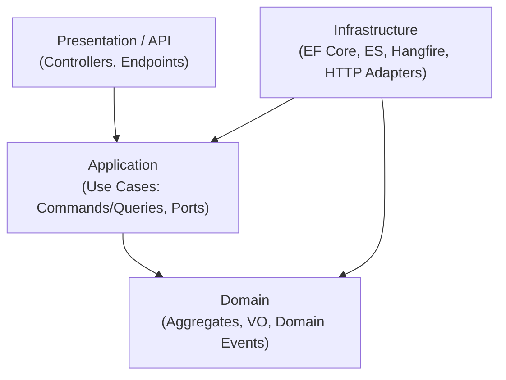
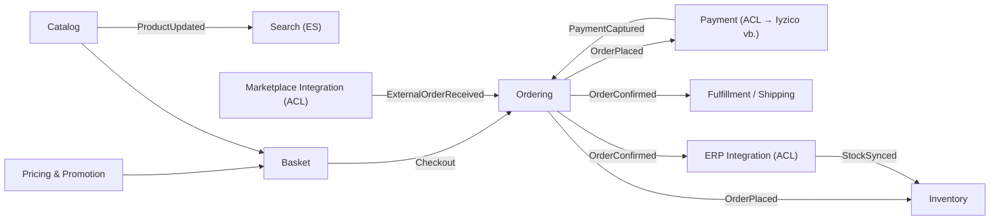
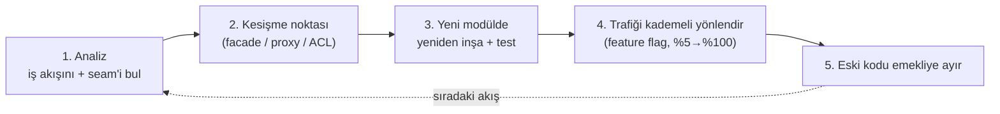
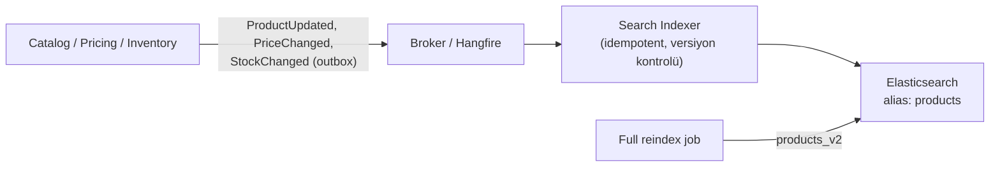
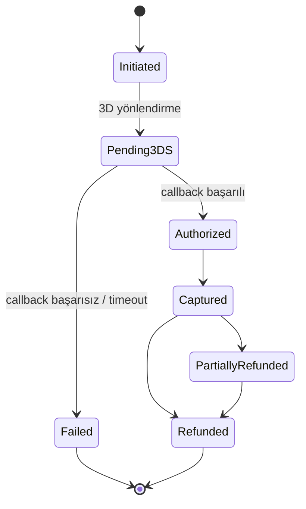
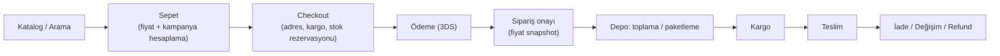

# 🧭 Supplementler.com — Mid Level Backend Developer (.NET) Mülakat Yol Haritası

> **Kaynak:** [JobDescription.md](JobDescription.md) · **Hazırlık tarihi:** Ekim 2026
> **Bağlantılı notlar:** [../net](../net) klasörü · [Kendim Hakkında](../AboutMySelf.MD) · [Hikayelerim](../MySelf.MD)
>
> **Kullanım:** Önce **Bölüm 0–3**'ü oku (strateji). Sonra **Bölüm 4**'teki başlıkları yol haritasındaki sırayla çalış. Her başlık şu kalıpta: **📌 İlandaki karşılığı → 🧠 Bilmen gerekenler → ❓ Olası sorular + model cevap → 🎯 Senin hikayen → 🔗 Notların.**

---

## 📑 İçindekiler

- [0. Pozisyonun Röntgeni](#0-pozisyonun-röntgeni)
- [1. Mülakat Süreci (Tahmini Aşamalar)](#1-mülakat-süreci-tahmini-aşamalar)
- [2. Adım Adım Hazırlık Yol Haritası](#2-adım-adım-hazırlık-yol-haritası)
- [3. Öncelik Matrisi](#3-öncelik-matrisi)
- [4. Mülakat Başlıkları](#4-mülakat-başlıkları)
  - **A. Açılış ve Bağlam**
    - [B1. Açılış: Kendini Tanıtma ve Motivasyon](#b1-açılış-kendini-tanıtma-ve-motivasyon)
    - [B2. Şirket ve İş Alanı Bilgisi](#b2-şirket-ve-iş-alanı-bilgisi)
  - **B. .NET Temeli**
    - [B3. C# ve .NET Temelleri](#b3-c-ve-net-temelleri)
    - [B4. .NET Framework → Modern .NET Geçişi](#b4-net-framework--modern-net-geçişi)
  - **C. Mimari Çekirdek (ilanın kalbi)**
    - [B5. SOLID — Ezber Değil, Gerekçeleriyle](#b5-solid--ezber-değil-gerekçeleriyle)
    - [B6. Clean Architecture, Ports & Adapters ve Architecture Tests](#b6-clean-architecture-ports--adapters-ve-architecture-tests)
    - [B7. DDD — Taktik Desenler](#b7-ddd--taktik-desenler)
    - [B8. DDD — Stratejik Desenler](#b8-ddd--stratejik-desenler)
    - [B9. Modüler Monolith](#b9-modüler-monolith)
    - [B10. Legacy Refactoring ve Strangler Fig](#b10-legacy-refactoring-ve-strangler-fig)
    - [B11. Modülden Mikroservise Geçiş](#b11-modülden-mikroservise-geçiş)
    - [B12. CQRS, MediatR ve FluentValidation](#b12-cqrs-mediatr-ve-fluentvalidation)
    - [B13. Event-Driven Mimari ve Asenkron İletişim](#b13-event-driven-mimari-ve-asenkron-iletişim)
  - **D. Veri ve Altyapı**
    - [B14. SQL Server ve Entity Framework — Sorgu Performansı](#b14-sql-server-ve-entity-framework--sorgu-performansı)
    - [B15. Elasticsearch](#b15-elasticsearch)
    - [B16. Hangfire ve Background Job'lar](#b16-hangfire-ve-background-joblar)
  - **E. Domain ve Entegrasyon**
    - [B17. Entegrasyonlar: ERP, Pazaryeri, Ödeme](#b17-entegrasyonlar-erp-pazaryeri-ödeme)
    - [B18. E-Ticaret Domain'i ve NopCommerce](#b18-e-ticaret-domaini-ve-nopcommerce)
    - [B19. Yüksek Trafik: Performans ve Ölçeklenebilirlik](#b19-yüksek-trafik-performans-ve-ölçeklenebilirlik)
  - **F. Kalite, Araçlar ve Kültür**
    - [B20. Test Kültürü (xUnit) ve Test Edilebilir Tasarım](#b20-test-kültürü-xunit-ve-test-edilebilir-tasarım)
    - [B21. Agentic Coding ve AI Destekli Geliştirme](#b21-agentic-coding-ve-ai-destekli-geliştirme)
    - [B22. Code Review, Teknik Borç ve Convention'lar](#b22-code-review-teknik-borç-ve-conventionlar)
    - [B23. Scrum / Agile ve Uzaktan Çalışma](#b23-scrum--agile-ve-uzaktan-çalışma)
  - **G. Pratik Oturumlar**
    - [B24. Case Study / Live Coding Provası](#b24-case-study--live-coding-provası)
    - [B25. Sistem Tasarımı Senaryoları (E-Ticaret)](#b25-sistem-tasarımı-senaryoları-e-ticaret)
  - **H. Kapanış**
    - [B26. Davranışsal Sorular ve STAR Hikaye Haritası](#b26-davranışsal-sorular-ve-star-hikaye-haritası)
    - [B27. Mülakatçıya Sorulacak Sorular](#b27-mülakatçıya-sorulacak-sorular)
    - [B28. Lojistik, Pazarlık ve Kapanış](#b28-lojistik-pazarlık-ve-kapanış)
- [5. Son Gün Checklist](#5-son-gün-checklist)

---

## 0. Pozisyonun Röntgeni

### 0.1 İlanın tek cümlelik özeti

> **"Canlıda çalışan eski bir .NET Framework e-ticaret platformunu; DDD + Clean Architecture ile, strangler fig yaklaşımıyla modüler monolith'e, oradan da olgunlaşan modülleri mikroservislere taşıyacak; bunu yaparken testle, code review ile ve agentic AI araçlarıyla disiplinli çalışacak bir mühendis."**

### 0.2 Mülakatçının kafasındaki 6 soru

| # | Gizli soru | Nasıl cevap vereceksin |
|---|-----------|------------------------|
| 1 | **DDD'yi kitaptan mı biliyor, üretimde mi uyguladı?** ("kitaptan değil, üretimde" diyorlar) | Her kavramı **kendi projenden bir örnekle** anlat (Yemeksepeti sipariş, Drivee telemetri/alarm, Defacto iade). |
| 2 | **Legacy'yi canlıda kırmadan dönüştürebilir mi?** | Drivee monolit → mikroservis + Web Forms → React dönüşümü. Strangler, ACL, feature flag kelimelerini kullan. |
| 3 | **Mimari sınırlara sadık kalır mı?** | Architecture tests, modül sınırı kuralları, code review'da neye baktığın. |
| 4 | **AI araçlarını eleştirel kullanıyor mu?** | Copilot Review, SonarQube, kendi agentic iş akışın; "AI'ın kodunu testle doğrularım". |
| 5 | **Test yazıyor mu?** | Dürüst + bilgili konumlanma (B20). Domain testleri, characterization testleri. |
| 6 | **Mid Level rol için fazla kıdemli mi? Uyum sağlar mı, sıkılıp gider mi?** | Bölüm 0.4'teki cevap. |

### 0.3 İlan ↔ Senin deneyimin

| İlan maddesi | Senin kanıtın | Durum |
|--------------|---------------|-------|
| 3+ yıl C#/.NET, .NET FW ve/veya modern .NET | 10+ yıl; Web Forms/.NET FW'den .NET 8'e kadar | ✅ Güçlü |
| DDD (aggregate, VO, domain event, BC) üretimde | Drivee'de DDD ile servis sınırlarını belirleme; Yemeksepeti sipariş döngüsü | ✅ Güçlü — **taktik detayları tazele** |
| Clean Architecture / Ports & Adapters | Mikroservislerde katmanlı yapı, DH entegrasyon adapter'ları | 🟡 Architecture tests'i çalış |
| Legacy refactoring, kademeli dönüşüm | Drivee monolit → mikroservis, Web Forms → React | ✅ En büyük kozun |
| SQL Server + EF, sorgu performansı | Defacto (SQL Server), Drivee (PostgreSQL) | 🟡 SQL Server'a özgü konuları tazele (RCSI, parameter sniffing) |
| Event-driven, asenkron iletişim | Kafka + Debezium (Drivee), SQS (Yemeksepeti/DH) | ✅ Güçlü |
| Test kültürü (xUnit) | DH entegrasyon test framework'ü, SonarQube quality gate | 🟠 **Kendi zayıf alanın — hazırlan** |
| Agentic coding (Claude Code, Cursor, Copilot) | Copilot Review entegrasyonu, AI destekli geliştirme | 🟡 Somut anekdot hazırla |
| Yazılı/sözlü teknik iletişim, code review | Team Lead, global dağıtık ekipler (DH) | ✅ Güçlü |
| **Artı:** E-ticaret domain | Defacto, Yemeksepeti q-commerce, MetalAVM | ✅ Güçlü |
| **Artı:** NopCommerce | — | 🟠 Temel mimarisini öğren (B18) |
| **Artı:** Monolith → mikroservis | Drivee | ✅ |
| **Artı:** CQRS / MediatR | — (kullandıysan örnek hazırla) | 🟡 |
| **Artı:** Elasticsearch | — | 🟠 Temeli çalış (B15) |
| **Artı:** RabbitMQ / Kafka | Kafka | ✅ |
| **Artı:** Hangfire | — | 🟡 Kısa çalış (B16) |
| **Artı:** ERP / pazaryeri entegrasyonu | Defacto pazaryeri siparişleri, DH 3rd party entegrasyonları | ✅ Güçlü |
| **Artı:** Agentic workflow (MCP, custom agent, AI review) | Copilot Review | 🟡 MCP kavramını bil |

### 0.4 ⚠️ "Mid Level" başlığı — overqualified sorusuna hazır ol

Bu soru **kesin gelir** (İK veya teknik lider ağzından): *"Team Lead'sin, 10+ yıl deneyimin var; neden Mid Level bir rol?"*

> *"Benim için unvandan çok yaptığım iş önemli. Kendimi bir 'inşaatçı' olarak görüyorum; günümün çoğunu zaten kod yazarak ve mimari karar alarak geçiriyorum. Sizin ilanınızda gördüğüm şey tam olarak son yıllarda yaptığım iş: canlıdaki bir legacy sistemi DDD ile bounded context'lere ayırıp kademeli olarak modüler yapıya taşımak. Bu dönüşümün içinde olmak, e-ticaret domain'ine geri dönmek ve %100 uzaktan, mühendislik kültürü güçlü bir ekipte çalışmak bana çok cazip geliyor. Seviye etiketinden bağımsız olarak, dönüşüm sırasında tecrübemle ekibe değer katmak ve code review / junior mentorluğu tarafında da katkı vermek istiyorum."*

**Tuzağa düşme:** "Yöneticilikten sıkıldım" veya "Sadece remote olduğu için" deme. **Pozitif çerçeve:** domain + dönüşüm + kültür.

---

## 1. Mülakat Süreci (Tahmini Aşamalar)

> Not: Aşamalar ilandan çıkarılan **tahmindir**. İK ile ilk görüşmede süreci sormayı unutma.

| Aşama | Süre | Kim | Odak | Hazırlanacağın başlıklar |
|-------|------|-----|------|--------------------------|
| **1. İK ön görüşme** | 20–30 dk | İK / Talent | Motivasyon, remote, maaş, başlama tarihi, "neden mid?" | B1, B2, B28, 0.4 |
| **2. Teknik mülakat** | 60–90 dk | Tech Lead / Senior | DDD, Clean Arch, modüler monolith, legacy dönüşüm, SQL/EF, event-driven | B3–B16 |
| **3. Case / live coding / take-home** | 1–3 saat | Ekip | Aggregate tasarımı, MediatR handler + validator + test, legacy refactor | B24, B20, B12 |
| **4. Mimari / sistem tasarımı** (2. aşamaya gömülü olabilir) | 45–60 dk | Lead / Architect | Stok rezervasyonu, arama senkronizasyonu, pazaryeri entegrasyonu | B25, B17, B19 |
| **5. Kültür / yönetici görüşmesi** | 30–45 dk | Eng. Manager / CTO | Code review, teknik borç, AI kullanımı, takım uyumu | B21, B22, B26, B27 |

---

## 2. Adım Adım Hazırlık Yol Haritası

> Tahmini toplam: **~25–30 saat**. Mülakat tarihin yakınsa 🔴 adımlara öncelik ver (Bölüm 3).

```mermaid
flowchart LR
    A0["Adım 0<br/>Şirketi tanı"] --> A1["Adım 1<br/>Pitch + hikayeler"]
    A1 --> A2["Adım 2<br/>DDD + Clean Arch"]
    A2 --> A3["Adım 3<br/>Modüler monolith<br/>+ Strangler"]
    A3 --> A4["Adım 4<br/>CQRS + Event-driven"]
    A4 --> A5["Adım 5<br/>SQL/EF + ES + Hangfire"]
    A5 --> A6["Adım 6<br/>E-ticaret + Entegrasyon"]
    A6 --> A7["Adım 7<br/>Test + Arch Tests"]
    A7 --> A8["Adım 8<br/>Agentic coding"]
    A8 --> A9["Adım 9<br/>Prova: kod + tasarım"]
    A9 --> A10["Adım 10<br/>Davranışsal + Checklist"]
```



| Adım | Ne yapacaksın | Çıktı (kendini test et) | Başlıklar | Süre |
|------|---------------|--------------------------|-----------|------|
| **0. Şirketi tanı** | supplementler.com, vitaminler.com, fitmoda.com'da gez: arama, filtre, sepet, kampanya, ödeme adımları. DevTools'ta response header / HTML'e bak (nopCommerce izi var mı?). LinkedIn'de ekip üyelerine bak. | 3 sitenin ortak platformda çalıştığını ve hangi bounded context'lere ayrılabileceğini 2 dakikada anlatabiliyorum. | B2, B18 | 1–2 sa |
| **1. Pitch ve hikayeler** | 60 sn'lik Supplementler'e özel açılışı yaz ve sesli prova et. 6 STAR hikayesini ilana map'le. | Açılışı ezbere değil akıcı söylüyorum; "neden mid?" sorusuna hazırım. | B1, B26, 0.4 | 2 sa |
| **2. DDD + Clean Architecture** | Aggregate kuralları, VO, domain event, BC, context map; Clean Arch bağımlılık kuralı; SOLID gerekçeleri. | Beyaz tahtaya `Order` aggregate'ini invariant'larıyla çizebiliyorum. | B5, B6, B7, B8 | 5–6 sa |
| **3. Modüler monolith + Strangler** | Modül sınırı kuralları, modül başına şema, contracts; strangler fig, ACL, characterization test. **Kamil Grzybek – modular-monolith-with-ddd** reposunu incele. | "Legacy sipariş modülünü nasıl taşırsın?" sorusuna adım adım cevap verebiliyorum. | B9, B10, B11, B4 | 4 sa |
| **4. CQRS + Event-driven** | MediatR pipeline, FluentValidation vs domain invariant, outbox/inbox, idempotency, domain vs integration event. | Outbox'ı EF Core interceptor ile kodlayabiliyorum. | B12, B13 | 3 sa |
| **5. Veri ve altyapı** | SQL Server index/plan/parameter sniffing/RCSI, EF performans; ES mapping/analyzer/alias; Hangfire job tipleri. | Yavaş sorgu teşhis adımlarını sırayla sayabiliyorum; ES'te sıfır kesintili reindex'i anlatabiliyorum. | B14, B15, B16 | 4 sa |
| **6. E-ticaret + Entegrasyon** | Sepet/kampanya/sipariş/stok akışları, ödeme state machine, pazaryeri/ERP adapter'ları, resilience. | "Ödeme sağlayıcı timeout verdi" senaryosunu cevaplayabiliyorum. | B17, B18, B19 | 3 sa |
| **7. Test** | xUnit fixture'ları, Testcontainers, NetArchTest, domain testleri. Küçük bir test projesi yaz. | Bir aggregate için 5 test + 2 architecture test yazdım. | B20, B6 | 2–3 sa |
| **8. Agentic coding** | AI ile yakaladığın bir hata anekdotu; context dosyaları (AGENTS.md, CLAUDE.md), MCP; AI review akışı. | "AI'ı nasıl kullanıyorsun, nasıl doğruluyorsun?" sorusuna somut cevap verebiliyorum. | B21, B22 | 1 sa |
| **9. Prova** | 45 dk süre tutarak B24'teki görevi kodla; B25'ten 2 senaryoyu sesli tasarla. | Sesli düşünerek, trade-off söyleyerek bitirdim. | B24, B25 | 3 sa |
| **10. Kapanış** | Sorulacak soruları seç, maaş aralığını belirle, checklist'i geç. | Bölüm 5 checklist tamam. | B27, B28, 5 | 1 sa |

---

## 3. Öncelik Matrisi

| Öncelik | Başlıklar | Neden |
|---------|-----------|-------|
| 🔴 **Kritik** (mutlaka) | B7 DDD Taktik, B8 DDD Stratejik, B9 Modüler Monolith, B10 Strangler, B6 Clean Arch, B5 SOLID, B1 Açılış, 0.4 Mid sorusu | İlanın kalbi; "kitaptan değil üretimde" vurgusu. |
| 🟠 **Yüksek** | B12 CQRS/MediatR, B13 Event-driven, B14 SQL/EF, B20 Test, B21 Agentic, B17 Entegrasyon | Aranan nitelikler listesinde açıkça var. |
| 🟡 **Orta** | B4 FW→Core, B11 Mikroservis, B15 ES, B16 Hangfire, B18 E-ticaret/nop, B19 Performans, B22 Code review | Artı puan + günlük işin parçası. |
| 🟢 **Düşük** | B3 temel .NET (zaten güçlüsün), B23 Scrum, B28 Lojistik | Kısa tazeleme yeterli. |

---

## 4. Mülakat Başlıkları

---

## A. Açılış ve Bağlam

### B1. Açılış: Kendini Tanıtma ve Motivasyon

**📌 İlandaki karşılığı:** Tüm ilan. İlk 60 saniyede mülakatçı "bu kişi bizim dönüşüm hikayemize uyar mı?" kararını verir.

**🧠 Strateji:** Mevcut genel açılışını ([AboutMySelf.MD](../AboutMySelf.MD)) **e-ticaret + legacy dönüşüm + DDD** ekseninde yeniden sırala. Telematik detayını kısa tut; Defacto ve Yemeksepeti'yi öne çek.

**🎤 Supplementler'e özel açılış (Türkçe, ~60 sn):**

> *"Merhaba, zaman ayırdığınız için teşekkürler. .NET ekosisteminde 10 yılı aşkın deneyimi olan, uygulamalı çalışan bir backend geliştiricisiyim. Kariyerimin önemli bir kısmı e-ticarette geçti: Defacto'da pazaryeri siparişlerinden hazırlık, teslimat ve iade süreçlerine kadar sipariş akışlarında çalıştım; Yemeksepeti'nde yoğun trafik altında quick-commerce mikroservislerini sıfırdan tasarladık; Delivery Hero'da ise global 3. parti entegrasyon altyapısını ve entegrasyon test framework'ünü kurduk.*
>
> *Şu an Drivee'de, ilk mimarı olduğum monolitik bir sistemi canlıda çalışır tutarak DDD ile servis sınırlarını belirleyip Kafka tabanlı, event-driven bir mikroservis mimarisine taşıdım. İlanınızda anlattığınız yolculuk — legacy .NET Framework platformunu strangler fig ile modüler monolith'e, oradan mikroservislere taşımak — tam olarak son yıllarda yaşadığım ve en çok keyif aldığım iş. Bu yüzden ilanı gördüğümde 'bu benim hikayem' dedim."*

**❓ Olası sorular:**

- **"Neden Drivee'den ayrılmak istiyorsun?"**
  > *"Drivee'de dönüşümü tamamladık ve sistem olgun bir noktaya geldi. Ben en çok dönüşümün içinde olmaktan ve e-ticaret gibi iş kurallarının yoğun olduğu domain'lerde çalışmaktan keyif alıyorum. Sizin şu an tam bu yolculuğun ortasında olmanız beni heyecanlandırıyor."* (Mevcut şirketi kötüleme.)
- **"Neden Supplementler?"** → Domain (e-ticaret, 3 marka, kendi markaları), mühendislik kültürü (architecture tests CI'da, teknik borç çıkış koşuluyla, yazılı convention'lar), agentic coding'i ciddiye almaları, yeşil + kahverengi alan dengesi.
- **"Neden Mid Level?"** → [Bölüm 0.4](#0-pozisyonun-röntgeni) ("Mid Level" başlığı).

**🔗 Notların:** [AboutMySelf.MD](../AboutMySelf.MD) · [Summary.md – Açılış](../net/Summary.md)

---

### B2. Şirket ve İş Alanı Bilgisi

**📌 İlandaki karşılığı:** "Biz Kimiz" bölümü.

**🧠 Bilmen gerekenler:**

- **Dikey Vitamin A.Ş.** — 2012'de kuruldu. 3 e-ticaret sitesi işletiyor:
  - **Supplementler.com** — sporcu gıdaları ve takviyeler (lider marka)
  - **Vitaminler.com** — vitamin, mineral, sağlıklı atıştırmalık
  - **Fitmoda.com** — spor ekipmanı, aksesuar, tekstil
- Global markaların yanında **kendi yerel üretim markaları** var → üretim/tedarik, ERP entegrasyonu, lot/SKT takibi önemli olabilir.
- **Teknoloji Operasyonları ekibi**, %100 remote.
- **Platform:** Uzun yıllardır üretimde olan **.NET Framework** tabanlı bir platform; ilk mikroservisler canlıda. İlan nopCommerce'ten bahsediyor → legacy'nin **nopCommerce tabanlı veya ondan esinlenmiş** olma ihtimali yüksek (bunu **soru olarak** sor, iddia etme).

**🧠 Domain'e özgü gözlemler (sohbette kullanabileceğin):**

- **Tek platform, çok vitrin (multi-store):** 3 site muhtemelen aynı katalog/sipariş altyapısını paylaşıyor → "Channel/Store" kavramı her BC'de bir boyut.
- **Takviye ürünlerinde SKT ve lot takibi:** Stok tarafında FEFO (First-Expired-First-Out) mantığı gerekebilir.
- **Varyantlar:** Aroma, gramaj, beden (Fitmoda) → ürün/varyant modeli.
- **Kampanya yoğunluğu:** Sporcu gıdasında "2 al 1 öde", kupon, sepette indirim, hediye shaker vb. → kampanya motoru kritik.
- **Abonelik/tekrarlı sipariş** potansiyeli (protein tozu düzenli tüketilir).

**❓ Olası soru:** *"Sitemizi inceledin mi? Ne dikkatini çekti?"*
> Arama + filtre deneyimi (Elasticsearch facet'leri), sepet kampanyaları, ödeme adımları hakkında **1 olumlu + 1 merak ettiğin** teknik gözlem söyle. (Ör: *"Aramada 'kreatin' ve 'creatine' aynı sonucu getiriyor mu diye baktım — synonym/analyzer konfigürasyonunu merak ettim."*)

---

## B. .NET Temeli

### B3. C# ve .NET Temelleri

**📌 İlandaki karşılığı:** "C#/.NET ekosisteminde güçlü teknik bilgi birikimi (.NET Framework ve/veya modern .NET deneyimi)"

**🧠 Hızlı tazeleme listesi:**

| Konu | Mülakatta tek cümle |
|------|---------------------|
| `IEnumerable` vs `IQueryable` | `IQueryable` expression tree taşır, EF bunu SQL'e çevirir; `IEnumerable`'a erken düşersen filtre **bellekte** çalışır. |
| async/await | Derleyici state machine üretir; I/O beklerken thread'i havuza iade eder. **"Async all the way down."** |
| `.Result` / `.Wait()` | Thread pool starvation; **.NET Framework ASP.NET'te `SynchronizationContext` yüzünden deadlock**. ASP.NET Core'da SyncContext yok ama starvation yine var. |
| `ConfigureAwait(false)` | Library kodunda ve **legacy ASP.NET**'te önemli; ASP.NET Core app kodunda etkisi yok. |
| DI lifetimes | Singleton / Scoped / Transient. **Captive dependency:** Singleton içine Scoped (`DbContext`) enjekte etmek = hata. |
| `record` | Value equality + immutability → **Value Object** için ideal. |
| `struct` vs `class` | Değer vs referans semantiği. ⚠️ "Struct her zaman stack'te yaşar" **yanlış** — class'ın alanıysa veya boxing olursa heap'tedir. |
| Exception vs Result pattern | Beklenen iş hataları (yetersiz stok) için Result/hata kodu; beklenmeyen için exception. İlandaki **"exception ve mesaj kodları" convention'ı**na bağla. |
| Middleware pipeline | Sıra önemli: exception handling → auth → routing → endpoint. |
| `IHttpClientFactory` | Socket exhaustion ve DNS problemini çözer; resilience handler eklenir. |

**❓ Olası sorular:**

- **"Legacy .NET Framework uygulamasında `.Result` kullanılan bir kod gördün, ne olur?"**
  > *"Klasik ASP.NET'te request bir `AspNetSynchronizationContext` üzerinde çalışır. `.Result` thread'i bloklar; await'in continuation'ı aynı context'e dönmek ister ama context bloklu → deadlock. Kısa vadede `ConfigureAwait(false)` ile hafifletilir, doğru çözüm zinciri uçtan uca async yapmak. Legacy'de bunu kademeli yaparım; önce en sıcak endpoint'lerden başlarım."*
- **"Scoped bir servisi Hangfire job'ında / BackgroundService'te nasıl kullanırsın?"**
  > *"`IServiceScopeFactory` ile her iş birimi için yeni scope açarım; DbContext'i singleton'a bağlamam."*

**🔗 Notların:** [ConcurrencyAndAsync.MD](../net/ConcurrencyAndAsync.MD) · [MemoryManagement.MD](../net/MemoryManagement.MD) · [GarbageCollector.MD](../net/GarbageCollector.MD) · [Full Stack Dosyası §2–§3](<../net/Full Stack Mülakat Dosyası.md>)

---

### B4. .NET Framework → Modern .NET Geçişi

**📌 İlandaki karşılığı:** ".Net FW tabanlı platformumuzu, sistemi canlıda çalışır tutarak modüler monolith mimariye taşıyoruz"

**🧠 Bilmen gerekenler:**

| .NET Framework | Modern .NET (8/10 LTS) |
|----------------|------------------------|
| `System.Web`, `HttpContext.Current` (static) | `HttpContext` DI ile, static yok |
| `Global.asax`, `web.config` | `Program.cs`, `appsettings.json`, Options pattern |
| EF6 | EF Core (farklı API, farklı davranış) |
| WCF server | gRPC / REST / CoreWCF |
| Sadece Windows/IIS | Cross-platform, container, Kestrel |
| Autofac/Unity zorunluluğu | Built-in DI (Autofac hâlâ kullanılabilir) |

**Geçiş stratejileri:**

1. **Paylaşılan kütüphaneleri `.NET Standard 2.0`'a çek** → hem FW hem modern .NET kullanabilir.
2. **Incremental migration (YARP ile strangler):** Önde yeni ASP.NET Core uygulaması durur; taşınmış endpoint'leri kendisi karşılar, geri kalan her şeyi legacy'ye proxy'ler.
3. **System.Web Adapters** (`Microsoft.AspNetCore.SystemWebAdapters`): Session/auth paylaşımı ve `HttpContext` API uyumluluğu.
4. **Araçlar:** .NET Upgrade Assistant (Microsoft son dönemde yerini **GitHub Copilot app modernization** aracına bırakıyor — agentic coding ile güzel bir bağlantı noktası).

```csharp
// Yeni ASP.NET Core uygulaması: strangler fig'in "kapısı"
builder.Services.AddHttpForwarder();
var app = builder.Build();

app.MapControllers(); // Taşınmış endpoint'ler burada karşılanır

// Geri kalan her şey legacy .NET Framework uygulamasına gider
app.MapForwarder("/{**catch-all}", builder.Configuration["LegacyAppUrl"]!)
   .Add(e => ((RouteEndpointBuilder)e).Order = int.MaxValue);
```

**❓ Olası sorular:**

- **"Legacy ile yeni uygulama arasında oturum/kimlik doğrulama nasıl paylaşılır?"**
  > *"Seçenekler: System.Web Adapters ile remote session/remote authentication; ya da ortak bir token tabanlı yapı (cookie yerine JWT / ortak data protection key ring). Geçiş döneminde en az kırılgan olanı seçerim."*
- **"Big-bang rewrite neden yapmıyoruz?"**
  > *"Big-bang rewrite iş değeri üretmeden aylarca sürer, eski sistemin belgelenmemiş iş kuralları kaybolur ve risk tek bir güne yığılır. Strangler ile her adım canlıya çıkar, geri alınabilir ve değer erken gelir."*

**🔗 Notların:** [Deployment.MD](../net/Deployment.MD) · [Full Stack Dosyası §3.8 .NET yenilikleri](<../net/Full Stack Mülakat Dosyası.md>)

---

## C. Mimari Çekirdek (İlanın Kalbi)

### B5. SOLID — Ezber Değil, Gerekçeleriyle

**📌 İlandaki karşılığı:** "SOLID prensiplerinin **ezbere değil gerekçeleriyle** bilinmesi"

**🧠 Her prensip = Çözdüğü problem + E-ticaret örneği + Ne zaman uygulamam**

| Prensip | Hangi acıyı çözer? | E-ticaret örneği | Aşırısı / ne zaman uygulamam |
|---------|--------------------|------------------|------------------------------|
| **S**RP | Bir değişikliğin alakasız kodu kırması. Doğru tanım: *"Bir modül tek bir aktöre (paydaşa) karşı sorumlu olmalı."* | `OrderService` hem fiyat hesaplıyor, hem e-posta atıyor, hem ERP'ye yazıyor → finans ekibinin istediği değişiklik e-postayı kırıyor. | Her metodu ayrı sınıfa bölmek (class explosion). |
| **O**CP | Yeni özellik için çalışan kodu değiştirme riski. | Yeni kampanya türü (X al Y öde) eklemek için `if-else` zincirine dokunmak yerine yeni `IDiscountRule` eklemek. | Değişmesi beklenmeyen yere soyutlama koymak (YAGNI). |
| **L**SP | Alt tipin beklenmedik davranışla çağıranı kırması. | `DigitalGiftCard : Product` sınıfı `Ship()` çağrıldığında exception atıyorsa LSP ihlali → "kargolanabilir" ayrı bir yetenek olmalı. | — (ihlali hep sorun, ama kalıtımı az kullan). |
| **I**SP | Kullanılmayan metotlara bağımlılık, sahte implementasyonlar. | `IPaymentProvider` içinde `Refund`, `Installments`, `Tokenize` var; bazı sağlayıcılar desteklemiyor → `IRefundable`, `ISupportsInstallments` ayır. | Tek metotlu yüzlerce interface. |
| **D**IP | Yüksek seviye iş kuralının altyapıya bağımlı olması (test edilemezlik, değişim maliyeti). | Domain/Application `IPaymentGateway` port'unu tanımlar; `IyzicoAdapter` Infrastructure'da. **Clean Architecture'ın temeli budur.** | Hiç değişmeyecek, test gerektirmeyen basit yardımcılar için interface. |

**❓ Olası sorular:**

- **"SOLID'den en çok hangisini önemsersin, neden?"**
  > *"DIP. Çünkü dönüşüm projelerinde bize hareket alanı veren o: iş kuralları altyapıya bağımlı değilse, EF6'dan EF Core'a, monolitten servise, bir ödeme sağlayıcıdan diğerine geçerken domain'e dokunmayız. Clean Architecture ve Ports & Adapters da aslında DIP'in mimari ölçekteki uygulaması."*
- **"SRP'yi 'bir sınıf tek bir iş yapar' diye tanımlarsam yanlış mı?"**
  > *"Eksik. Uncle Bob'un netleştirdiği hali 'değişmek için tek bir nedeni olmalı', daha doğrusu 'tek bir aktöre hizmet etmeli'. Mesela fatura hesaplamasını finans, sipariş ekranını ürün ekibi değiştirir; ikisini aynı sınıfa koyarsam birinin isteği diğerini kırar."*
- **"Legacy kodda SOLID ihlali gördün, hemen refactor eder misin?"**
  > *"Hayır. Önce testle güvence altına alırım (characterization test), o alana bir iş zaten dokunuyorsa 'boy scout rule' ile iyileştiririm. Dokunulmayan, çalışan koda sırf güzel olsun diye girmem; teknik borç olarak işaretleyip çıkış koşuluyla takip ederim."*

**🔗 Notların:** [SOLID.MD](../net/SOLID.MD) · [DesignPatterns.MD](../net/DesignPatterns.MD) · [Full Stack Dosyası §4.5](<../net/Full Stack Mülakat Dosyası.md>)

---

### B6. Clean Architecture, Ports & Adapters ve Architecture Tests

**📌 İlandaki karşılığı:** "Clean Architecture — katman sınırları **mimari testlerle (architecture tests) otomatik korunuyor**" · "Clean Architecture / Ports & Adapters prensiplerine dair bilgi ve deneyim" · "Mimari sınırlar sözde kalmaz; architecture test'lerle CI'da otomatik doğrulanır"

**🧠 Bilmen gerekenler:**



- **Bağımlılık kuralı (Dependency Rule):** Bağımlılıklar **içe** doğru akar. Domain hiçbir şeye bağımlı değildir (EF, MediatR, ASP.NET yok).
- **Ports & Adapters (Hexagonal):**
  - **Port** = Uygulamanın tanımladığı arayüz (`IOrderRepository`, `IPaymentGateway`, `ISearchIndexer`).
  - **Driving (primary) adapter** = Uygulamayı tetikleyen: API controller, Hangfire job, message consumer.
  - **Driven (secondary) adapter** = Uygulamanın çağırdığı: EF repository, Iyzico client, Elasticsearch client, ERP client.
- **Onion / Hexagonal / Clean** — aynı fikrin farklı çizimleri: iş kuralları merkezde, altyapı kenarda.
- **Vertical Slice** — feature bazlı klasörleme; Clean Architecture ile çelişmez, **modül içinde** birlikte kullanılabilir.

**Architecture tests** (NetArchTest.Rules / ArchUnitNET) — CI'da çalışır, sınır ihlalinde build kırılır:

```csharp
public class ArchitectureTests
{
    private const string Infrastructure = "Ordering.Infrastructure";

    [Fact]
    public void Domain_Should_Not_Depend_On_Infrastructure_Or_EF()
    {
        var result = Types.InAssembly(typeof(Order).Assembly)
            .ShouldNot()
            .HaveDependencyOnAny(Infrastructure, "Microsoft.EntityFrameworkCore", "MediatR")
            .GetResult();

        Assert.True(result.IsSuccessful, string.Join(", ", result.FailingTypeNames ?? []));
    }

    [Fact]
    public void Ordering_Module_Should_Not_Reference_Catalog_Internals()
    {
        // Modüller birbirinin sadece *.Contracts projesini görebilir
        var result = Types.InAssembly(typeof(OrderingModule).Assembly)
            .ShouldNot()
            .HaveDependencyOnAny("Catalog.Domain", "Catalog.Application", "Catalog.Infrastructure")
            .GetResult();

        Assert.True(result.IsSuccessful, string.Join(", ", result.FailingTypeNames ?? []));
    }

    [Fact]
    public void Handlers_Should_Be_Sealed_And_Internal() =>
        Assert.True(Types.InAssembly(typeof(OrderingModule).Assembly)
            .That().ImplementInterface(typeof(IRequestHandler<,>))
            .Should().BeSealed().And().NotBePublic()
            .GetResult().IsSuccessful);
}
```

**❓ Olası sorular:**

- **"Repository interface'i nerede durur?"**
  > *"Aggregate başına repository ise Domain'de (veya Application'da) port olarak durur, implementasyonu Infrastructure'dadır. Generic `IRepository<T>` yerine aggregate'e özel, anlamlı metotlar tercih ederim: `GetByIdAsync`, `Add`. Sorgu tarafında repository'ye gerek yok, query handler doğrudan okuma modeline gidebilir."*
- **"EF entity ile domain entity aynı sınıf mı olmalı?"**
  > *"Pragmatik cevap: EF Core yeterince esnek (private setter, backing field, owned/complex types) olduğu için çoğu durumda aynı sınıfı kullanırım; Domain projesi EF'e referans vermez, mapping Infrastructure'da Fluent API ile yapılır. Legacy şema domain modeline çok uzaksa ayrı persistence modeli + mapping ile ACL kurarım — maliyeti yüksek, sadece gerektiğinde."*
- **"Clean Architecture over-engineering değil mi?"**
  > *"Basit CRUD modülü için evet olabilir — orada katmanları inceltirim. Ama iş kuralı yoğun, uzun ömürlü, altyapısı değişecek bir sistemde (sizin dönüşümünüz gibi) yatırımı geri öder. Asıl değeri bağımlılık yönünü korumak; klasör sayısı değil."*
- **"Architecture test'lerin ne faydası var, code review yetmez mi?"**
  > *"Code review insan dikkatine dayanır ve ölçeklenmez; özellikle AI araçlarıyla kod üretim hızı arttığında sınır ihlalleri gözden kaçar. Architecture test kuralı bir kere yazılır, her PR'da sıfır maliyetle çalışır. Review'ı tasarım tartışmasına ayırır."* ⭐ (Agentic coding ile bağlantı kur.)

**🔗 Notların:** [SOLID.MD](../net/SOLID.MD) · [CrossCuttingConcerns.MD](../net/CrossCuttingConcerns.MD) · [Full Stack Dosyası §4.1, §4.3](<../net/Full Stack Mülakat Dosyası.md>)

---

### B7. DDD — Taktik Desenler

**📌 İlandaki karşılığı:** "Domain-Driven Design — aggregate, value object, domain event, bounded context; **kitaptan değil, üretimde**" · "İş kurallarını domain modeline doğru yansıtarak..."

**🧠 Kavramlar:**

| Kavram | Tanım | E-ticaret örneği |
|--------|-------|------------------|
| **Entity** | Kimliği olan, zaman içinde değişen nesne. Eşitlik = Id. | `Order`, `Customer`, `Product` |
| **Value Object** | Kimliği yok, değerleriyle eşit, **immutable**, kendi kuralını doğrular. | `Money`, `Address`, `Quantity`, `Sku`, `Email`, `DateRange` |
| **Aggregate** | Birlikte tutarlı kalması gereken nesneler kümesi; **tutarlılık (transaction) sınırı**. Dışarıdan sadece **root** üzerinden erişilir. | `Order` (root) + `OrderLine`'lar |
| **Invariant** | Aggregate'in her an doğru olması gereken iş kuralı. | "Gönderilmiş sipariş değiştirilemez", "Sipariş toplamı ≥ 0", "Bir kupon bir siparişte bir kez" |
| **Domain Event** | Domain'de olmuş, iş açısından anlamlı bir olay (geçmiş zaman). | `OrderPlaced`, `PaymentCaptured`, `StockDepleted` |
| **Domain Service** | Tek bir aggregate'e ait olmayan iş mantığı. | `PricingService` (ürün + kampanya + müşteri segmenti) |
| **Repository** | Aggregate'i koleksiyon gibi yükleyip kaydetme soyutlaması; **aggregate root başına bir**. | `IOrderRepository` |
| **Factory** | Karmaşık oluşturma mantığı. | `Order.CreateFromBasket(basket, pricing)` |
| **Specification** | Yeniden kullanılabilir iş kuralı / sorgu predicate'i. | `EligibleForFreeShippingSpec` |

**Vaughn Vernon'un 4 aggregate kuralı (ezberle, gerekçesiyle söyle):**

1. **Gerçek invariant'ları tutarlılık sınırı içinde modelle.**
2. **Aggregate'leri küçük tasarla.** (Büyük aggregate = kilit çakışması, yavaş yükleme.)
3. **Diğer aggregate'lere sadece Id ile referans ver.** (`Order` içinde `Product` nesnesi değil, `ProductId`.)
4. **Sınır dışında eventual consistency kullan.** (Bir transaction'da bir aggregate değişir; diğerleri domain event ile güncellenir.)

**Kod — üretim kalitesinde örnek:**

```csharp
// --- Value Object ---
public sealed record Money
{
    public decimal Amount { get; }
    public string Currency { get; }

    public Money(decimal amount, string currency)
    {
        if (amount < 0) throw new DomainException(ErrorCodes.Money.Negative);
        if (string.IsNullOrWhiteSpace(currency)) throw new DomainException(ErrorCodes.Money.CurrencyRequired);
        Amount = decimal.Round(amount, 2);
        Currency = currency;
    }

    public static Money Zero(string currency) => new(0, currency);
    public static Money TRY(decimal amount) => new(amount, "TRY");

    public Money Add(Money other)
    {
        if (Currency != other.Currency) throw new DomainException(ErrorCodes.Money.CurrencyMismatch);
        return new Money(Amount + other.Amount, Currency);
    }

    public Money Multiply(int factor) => new(Amount * factor, Currency);
}

// --- Aggregate Root base ---
public abstract class AggregateRoot<TId> : Entity<TId>, IHasDomainEvents
{
    private readonly List<IDomainEvent> _domainEvents = [];
    public IReadOnlyCollection<IDomainEvent> DomainEvents => _domainEvents.AsReadOnly();
    protected void Raise(IDomainEvent domainEvent) => _domainEvents.Add(domainEvent);
    public void ClearDomainEvents() => _domainEvents.Clear();
}

// --- Aggregate ---
public sealed class Order : AggregateRoot<OrderId>
{
    private readonly List<OrderLine> _lines = [];
    public IReadOnlyCollection<OrderLine> Lines => _lines.AsReadOnly();
    public CustomerId CustomerId { get; private set; } = default!;
    public OrderStatus Status { get; private set; }

    private Order() { } // EF Core için

    public static Order Create(CustomerId customerId) =>
        new() { Id = OrderId.New(), CustomerId = customerId, Status = OrderStatus.Draft };

    public void AddLine(ProductId productId, int quantity, Money unitPrice)
    {
        if (Status != OrderStatus.Draft) throw new DomainException(ErrorCodes.Order.NotEditable);
        if (quantity <= 0) throw new DomainException(ErrorCodes.Order.InvalidQuantity);

        var existing = _lines.SingleOrDefault(l => l.ProductId == productId);
        if (existing is not null) existing.IncreaseQuantity(quantity);
        else _lines.Add(new OrderLine(productId, quantity, unitPrice));
    }

    public void Place()
    {
        if (Status != OrderStatus.Draft) throw new DomainException(ErrorCodes.Order.AlreadyPlaced);
        if (_lines.Count == 0) throw new DomainException(ErrorCodes.Order.Empty);

        Status = OrderStatus.Placed;
        Raise(new OrderPlacedDomainEvent(Id, CustomerId, Total()));
    }

    public Money Total() =>
        _lines.Aggregate(Money.Zero("TRY"), (sum, line) => sum.Add(line.LineTotal));
}
```

**EF Core mapping ipuçları:** Value object için **owned types** veya EF Core 8+ **complex types**; strongly-typed Id için value converter; `_lines` için backing field (`Navigation(o => o.Lines).UsePropertyAccessMode(PropertyAccessMode.Field)`).

**❓ Olası sorular (üretim deneyimi sınayan):**

- **"Sepet (Basket) ve Sipariş (Order) aynı aggregate mı?"**
  > *"Hayır. Farklı yaşam döngüleri ve farklı invariant'ları var. Sepet geçici, sık değişen, misafir kullanıcıya da ait olabilen bir yapı; fiyatlar orada 'güncel' hesaplanır. Sipariş ise checkout anında **fiyatın snapshot'ını** alan, yasal/finansal olarak değişmez bir kayıt. Hatta çoğu zaman farklı bounded context'lerdedir."*
- **"Stok, `Product` aggregate'inin parçası mı?"**
  > *"Genelde değil. Katalog tarafında ürün açıklaması/görseli günde birkaç kez değişir, stok ise saniyede onlarca kez. Aynı aggregate'te olurlarsa concurrency çakışması yaşanır. Stoku `Inventory`/`StockItem` aggregate'i olarak ayrı bir context'te modellerim; ürüne ProductId/Sku ile referans verir."*
- **"Domain event'ler ne zaman dispatch edilir?"**
  > *"İki seçenek var: (1) `SaveChanges` **öncesi** aynı transaction içinde in-process handler'lar çalışır — aynı BC içindeki yan etkiler atomik olur ama transaction uzar. (2) `SaveChanges` **sonrası** — dış dünyaya giden her şey (e-posta, ERP, başka modül) için outbox'a yazar, commit sonrası işlerim. Ben dış etkileri hiçbir zaman commit öncesi yapmam; 'e-posta gitti ama sipariş rollback oldu' durumuna düşmemek için."*
- **"Domain event ile integration event farkı?"**
  > *"Domain event BC içinde, domain dilinde, in-process; zengin içerik taşıyabilir ve değişebilir. Integration event BC'ler/servisler arası bir **sözleşmedir**: versiyonlanır, sade tutulur, outbox üzerinden güvenilir şekilde yayınlanır. Bir domain event'i genelde bir handler integration event'e çevirir."*
- **"Anemic domain model nedir, legacy'de nasıl düzeltirsin?"**
  > *"Entity'lerin sadece getter/setter'dan oluşup tüm mantığın 'service' sınıflarına dağıldığı model. Legacy'de kademeli düzeltirim: önce public setter'ları kaldırıp davranışı (metodu) entity'ye taşırım, invariant'ları constructor/metotlarda korurum; her adımı testle güvenceye alırım."*
- **"Aggregate boyutuna nasıl karar verirsin?"**
  > *"'Hangi kurallar **aynı anda, anlık** tutarlı olmalı?' sorusuyla. Sipariş satırlarının toplamı sipariş ile anlık tutarlı olmalı → aynı aggregate. Müşterinin sadakat puanı sipariş sonrası birkaç saniye geç güncellenebilir → ayrı aggregate, event ile."*

**🎯 Senin hikayen:** Yemeksepeti q-commerce'te sipariş yaşam döngüsü (sipariş → mağaza onayı → hazırlık → kurye → teslim): hangi kurallar sipariş aggregate'indeydi, hangi geçişler event ile tetikleniyordu? Drivee'de alarm/kaza olayı → domain event örneği. **Bunu 1–2 dakikalık somut bir anlatı olarak hazırla.**

**🔗 Notların:** [Full Stack Dosyası §4.4 DDD](<../net/Full Stack Mülakat Dosyası.md>) · [DesignPatterns.MD](../net/DesignPatterns.MD)

---

### B8. DDD — Stratejik Desenler

**📌 İlandaki karşılığı:** "Bounded context'leri bugünden servis sınırı olacak şekilde tasarlamak" · "modül sınırlarını gözeterek geliştireceksin"

**🧠 Kavramlar:**

- **Ubiquitous Language:** İş birimi ile kodun aynı dili konuşması. "Sipariş iptali" ile "iade" farklı kavramlarsa kodda da farklıdır.
- **Subdomain türleri:**
  - **Core** (rekabet avantajı): Kampanya/fiyatlama, öneri, kendi markalarının yönetimi, arama deneyimi
  - **Supporting**: Sipariş yönetimi, iade, pazaryeri entegrasyonu
  - **Generic** (hazır al): Ödeme (Iyzico vb.), kimlik doğrulama, e-posta/SMS, kargo takip
- **Bounded Context:** Bir modelin ve dilin **geçerli olduğu sınır**. Aynı kelime farklı BC'lerde farklı anlam taşır.

**"Product" kelimesinin farklı BC'lerdeki anlamı (mülakatta altın örnek):**

| Bounded Context | "Product" ne demek? |
|-----------------|---------------------|
| **Catalog** | Ad, açıklama, görsel, marka, kategori, aroma/gramaj varyantları |
| **Pricing / Promotion** | Liste fiyatı, indirim kuralları, kampanya uygunluğu |
| **Inventory** | Sku, depo bazında miktar, rezervasyon, **lot/SKT** |
| **Ordering** | Sipariş anındaki ad + fiyat **snapshot**'ı |
| **Search** | Aranabilir doküman: analyzer'lı metin, facet alanları, boost değerleri |
| **Marketplace Integration** | Trendyol/Hepsiburada ürün kodu eşlemesi, komisyon |

**Supplementler için olası BC haritası:**



**Context Mapping desenleri:**

| Desen | Ne zaman |
|-------|----------|
| **Anti-Corruption Layer (ACL)** | Legacy veya dış sistemin (ERP, pazaryeri, ödeme) modeli bizimkini kirletmesin. **Strangler'da en çok kullanacağın desen.** |
| **Open Host Service + Published Language** | Bir BC'nin herkese sunduğu stabil API/event sözleşmesi. |
| **Customer / Supplier** | Upstream ekip downstream'in ihtiyaçlarını planına alır. |
| **Conformist** | Upstream'e uymak zorundasın (ör. pazaryeri API'si) — genelde ACL ile sarılır. |
| **Shared Kernel** | İki BC küçük ortak bir modeli paylaşır (ör. `Money`). Az ve dikkatli kullan. |
| **Separate Ways** | Entegrasyon maliyeti değerinden yüksekse. |

**❓ Olası sorular:**

- **"Bounded context'leri nasıl keşfedersin?"**
  > *"Teknik tablolardan değil, iş süreçlerinden başlarım. Event Storming ile domain uzmanlarıyla iş olaylarını (OrderPlaced, PaymentFailed...) zaman çizgisine dizeriz; dilin değiştiği, farklı ekiplerin sahiplendiği ve farklı değişim hızlarının olduğu yerler BC sınırlarını verir. Legacy'de ek olarak kodun değişim sıklığına (git hotspot analizi) ve tablolar arası bağımlılıklara bakarım. Drivee'den öğrendiğim bir ek kriter de **business criticality**: kritik akışları ayrı sınırda tutmak."* ⭐
- **"Bounded context = mikroservis mi?"**
  > *"Birebir değil. Bir BC bir veya birkaç servis olabilir, ama bir servis birden fazla BC'yi kapsamamalı. Sizin yaklaşımınız — BC'yi bugün modül sınırı, yarın servis sınırı olacak şekilde tasarlamak — bence en sağlıklısı: önce sınırları ucuz bir ortamda (tek deploy) doğrularsınız, yanlışsa düzeltmek kolaydır."*
- **"Core domain'iniz sizce ne?"** → *"Dışarıdan bakınca kampanya/fiyatlama, arama/keşif deneyimi ve kendi markalarınızın yönetimi gibi görünüyor; doğru mu?"* (Soruyu karşılıklı sohbete çevir.)

**🎯 Senin hikayen:** Drivee'de monoliti bölerken servis sınırlarını DDD ile belirleme; çağrı merkezi/kaza bildiriminin yanlış sınırda kalması ve **business criticality** dersi ([MySelf.MD](../MySelf.MD)).

**🔗 Notların:** [MicroServicePatterns.MD](../net/MicroServicePatterns.MD) · [Full Stack Dosyası §4.4](<../net/Full Stack Mülakat Dosyası.md>)

---

### B9. Modüler Monolith

**📌 İlandaki karşılığı:** "modüler monolith mimariye taşıyoruz" · "Yazılı convention'larımız var: ... modül sınırı kuralları"

**🧠 Tanım:** Tek deploy birimi, ama içeride **gerçek modül sınırları** olan sistem. Her modül = bir bounded context. Mikroservisin sınır disiplinini, monolitin operasyonel basitliğiyle birleştirir.

**Modül sınırı kuralları (muhtemelen onların convention'larına çok benzer):**

1. **Her modülün kendi şeması / DbContext'i var** (`ordering.*`, `catalog.*`). Modüller arası **JOIN yok**, başka modülün tablosuna yazma yok.
2. **Modül sadece `*.Contracts` (public API + integration event'ler) projesini dışa açar**; geri kalan her şey `internal`.
3. **Modüller arası iletişim:**
   - **Senkron sorgu** → Contracts'taki arayüz/sorgu üzerinden (in-process, ileride HTTP/gRPC'ye dönüşür).
   - **Asenkron** → Integration event'ler (in-memory bus veya outbox üzerinden). Tercih edilen budur.
4. **Modüller arası transaction yok** → eventual consistency.
5. **Kurallar architecture test'lerle CI'da korunur.**

```text
src/
├── Bootstrapper/Supplementler.Api          (tek host, modülleri register eder)
├── Modules/
│   ├── Ordering/
│   │   ├── Ordering.Domain
│   │   ├── Ordering.Application
│   │   ├── Ordering.Infrastructure        (OrderingDbContext → schema "ordering")
│   │   └── Ordering.Contracts             (IOrderingModule, OrderPlacedIntegrationEvent)
│   ├── Catalog/ ...
│   └── Inventory/ ...
├── BuildingBlocks/                        (AggregateRoot, Outbox, EventBus abstractions)
└── Tests/ArchitectureTests
```

**Artıları / eksileri:**

| ✅ Artı | ⚠️ Eksi |
|--------|---------|
| Tek deploy, basit operasyon, network gecikmesi yok | Tek ölçekleme birimi (tüm uygulama birlikte ölçeklenir) |
| Sınır hataları ucuza düzeltilir | Disiplin gerektirir; kurallar korunmazsa "big ball of mud"a döner |
| Mikroservise geçiş için "prova" | Bir modüldeki memory leak tüm uygulamayı etkiler |
| Debug, test, refactor kolay | Ortak veritabanı sunucusu (farklı şema olsa da) |

**❓ Olası sorular:**

- **"Sipariş listesinde ürün adı ve görseli göstermem gerek ama Catalog başka modül. Ne yaparsın?"**
  > *"Üç seçenek: (1) Sipariş satırında checkout anındaki ürün adını snapshot olarak tutmak — zaten iş kuralı gereği doğru olan bu. (2) Ordering modülünde Catalog'un `ProductUpdated` event'leriyle beslenen yerel bir read model. (3) API composition — UI/BFF iki modülden ayrı ayrı çekip birleştirir. Modüller arası JOIN asla; o, servise ayrılırken ilk kırılacak yer."*
- **"Bir use case iki modülde değişiklik gerektiriyorsa?"**
  > *"Önce sınırı sorgularım — sık oluyorsa sınır yanlış çizilmiş olabilir. Değilse bir modül kendi işini yapar ve integration event yayınlar, diğeri tepki verir. Telafi gerekiyorsa saga. Modüler monolitte iki modülü tek transaction'a almak teknik olarak mümkün ama bu, ayrıştırmayı imkânsız kılan bir bağ yaratır."*
- **"Modüler monolith'i mikroservise tercih etme sebebin ne olurdu?"**
  > *"Ekip büyüklüğü ve operasyonel olgunluk. Mikroservis; dağıtık transaction, network hatası, observability, deployment altyapısı gibi ciddi bir vergi getirir. Sınırlar henüz netleşmemişse önce modüler monolith; bir modülün bağımsız ölçeklenme, bağımsız deploy veya hata izolasyonu ihtiyacı kanıtlanınca ayırırım. Sizin 'olgunlaşan modülleri ayırma' yaklaşımınız tam bu."*

**📚 Mutlaka incele:** **Kamil Grzybek – `modular-monolith-with-ddd`** (GitHub). Stack'i (DDD, Clean Arch, MediatR, FluentValidation, NetArchTest, Outbox/Inbox) bu ilana neredeyse birebir uyuyor. Ayrıca Milan Jovanović'in modüler monolith içerikleri.

**🔗 Notların:** [MicroServicePatterns.MD](../net/MicroServicePatterns.MD) · [DistributedSystems.MD](../net/DistributedSystems.MD)

---

### B10. Legacy Refactoring ve Strangler Fig

**📌 İlandaki karşılığı:** "Legacy proje üzerindeki iş akışlarını analiz edip modüler monolith'e kademeli olarak taşınması sürecinde aktif rol alacaksın (**strangler fig** yaklaşımı)" · "Legacy kod tabanında refactoring deneyimi"

**🧠 Strangler Fig — 5 adım:**



**Araç kutusu:**

| Teknik | Ne işe yarar |
|--------|--------------|
| **Characterization (Golden Master) test** | Legacy'nin **şu anki** davranışını (bug'larıyla birlikte) kilitler. Refactor'ın güvencesi. |
| **Seam (Michael Feathers)** | Kodu değiştirmeden davranışı değiştirebileceğin nokta (interface, virtual metot, config). |
| **Sprout Method / Sprout Class** | Yeni mantığı eski metodun içine değil, yeni test edilebilir sınıfa yaz; eskisinden çağır. |
| **Wrap Method** | Eski metodu sarmalayıp öncesine/sonrasına yeni davranış ekle. |
| **Branch by Abstraction** | Eski ve yeni implementasyonu aynı arayüz arkasına koy, flag ile geçiş yap. |
| **Anti-Corruption Layer** | Yeni modül legacy'nin modelini görmez; çeviri katmanı. |
| **Parallel Run / Shadow Traffic** | Yeni ve eski aynı isteği işler, sonuçlar karşılaştırılır, sadece eskisinin sonucu döner. Fiyat/kampanya hesaplamasında çok değerli. |
| **Feature Flag** | Kademeli açılış, anında geri dönüş. |
| **CDC (Debezium) / event ile veri senkronizasyonu** | Geçiş döneminde eski ve yeni şema arasında veri akışı. ⚠️ Dual write'tan kaçın. |

**Hangi akışı önce taşırsın? (Önceliklendirme kriterleri)**

1. **Değişim sıklığı yüksek** (git hotspot: churn × complexity) — en çok acı veren yer.
2. **Bağımlılığı düşük / sınırı net** — erken başarı, ekibin pattern'i öğrenmesi.
3. **İş değeri yüksek** — yeni özellik isteği bekleyen alan.
4. **Risk** — ilk adımda ödeme gibi en kritik akışla başlamam; ama kritik akışlar **izole edilmeye** öncelikli adaydır (Drivee dersi).

**❓ Olası sorular:**

- **"Testi olmayan 3000 satırlık `OrderService.CreateOrder` metodunu nasıl refactor edersin?"** ⭐ (Çok olası)
  > 1. *"Önce anlamaya çalışırım: hangi iş kurallarını içeriyor, kimler çağırıyor, hangi tablolara yazıyor. Burada AI araçları çok işe yarıyor — kodu özetletip bağımlılık haritası çıkartırım, ama sonucu kodla doğrularım."*
  > 2. *"Characterization testleri yazarım: gerçekçi girdilerle mevcut çıktıyı kaydedip kilitlerim. Bağımlılıkları kırmak için seam'ler açarım (static çağrıları interface arkasına almak gibi)."*
  > 3. *"Küçük adımlarla: extract method → kuralları isimlendir → davranışı domain nesnelerine taşı (sprout class) → her adımda testler yeşil."*
  > 4. *"Yeni yapıyı branch by abstraction / feature flag ile devreye alırım; mümkünse parallel run ile sonuçları karşılaştırırım."*
  > 5. *"Eski kodu silmeden önce metriklerle doğrularım, sonra temizlerim. Kalan teknik borcu çıkış koşuluyla işaretlerim."*
- **"Strangler sürecinde yeni modül ile legacy aynı veritabanını kullanıyorsa?"**
  > *"Geçiş döneminde kabul edilebilir bir ara adım, ama bilinçli bir teknik borç. Kural: tablonun tek bir sahibi olur; diğer taraf yalnızca okur (tercihen view veya replike edilmiş read model üzerinden). Sahiplik yeni modüle geçince legacy'nin yazma yolu kapatılır. İki tarafın aynı tabloya yazması en tehlikeli durum."*
- **"Legacy'de belgelenmemiş bir iş kuralı keşfettin, yeni modülde ne yaparsın?"**
  > *"İş birimiyle doğrularım — bug mı, kural mı? Kuralsa ubiquitous language'a uygun isimle domain'e taşırım ve testini yazarım. Bug'sa düzeltmeyi taşımadan **ayrı** bir adım olarak yaparım; taşıma ve davranış değişikliğini aynı PR'da karıştırmam."* ⭐

**🎯 Senin hikayen:** Drivee monolit → mikroservis (Kafka + Debezium ile veri senkronizasyonu), Web Forms → React; ekibe direnç yönetimi; kaza bildirimi modülünün yanlış sırada bırakılması dersi. **Hepsi bu başlığın tam kalbinde.**

**🔗 Notların:** [MySelf.MD](../MySelf.MD) · [MicroServicePatterns.MD](../net/MicroServicePatterns.MD) · [Deployment.MD](../net/Deployment.MD)

---

### B11. Modülden Mikroservise Geçiş

**📌 İlandaki karşılığı:** "olgunlaşan modülleri mikroservislere ayırmak. İlk mikroservislerimiz şimdiden canlıda" · "Modüllerin bağımsız deploy edilebilir servislere dönüşme sürecinde tasarım kararlarına katkı"

**🧠 Bir modülü ne zaman ayırırım? (en az birinin kanıtı olmalı)**

- **Bağımsız ölçekleme:** Arama/katalog okuma trafiği, sipariş yazmadan 100x fazla.
- **Bağımsız deploy hızı:** Kampanya modülü haftada 10 kez değişiyor, ödeme ayda 1.
- **Hata izolasyonu:** Pazaryeri entegrasyonu çöktüğünde checkout etkilenmemeli.
- **Farklı teknoloji / kaynak ihtiyacı.**
- **Ekip sahipliği.**

**Ayırma için ön koşullar (checklist):**

- [ ] Modülün **kendi verisi** var, başka modülün tablosuna dokunmuyor
- [ ] Modüller arası iletişim zaten **contracts + integration event** üzerinden
- [ ] **Outbox** ile güvenilir event yayını var
- [ ] **Observability**: distributed tracing (OpenTelemetry), merkezi log, correlation id
- [ ] CI/CD pipeline'ı servis başına çalışabiliyor
- [ ] Resilience: timeout, retry, circuit breaker

**Ayırma adımları:** In-process contracts çağrısı → HTTP/gRPC client implementasyonu (aynı arayüz!) · in-memory event bus → gerçek broker (RabbitMQ/Kafka) · şema → ayrı veritabanı · ayrı deploy · gateway/BFF yönlendirmesi.

**⚠️ Anti-pattern: Distributed Monolith** — servisler ayrı deploy ediliyor ama birlikte deploy edilmek zorunda; senkron çağrı zincirleri; ortak veritabanı.

**❓ Olası sorular:**

- **"Servisler arası senkron mu asenkron mu iletişim?"**
  > *"Varsayılanım asenkron (event). Kullanıcı anında cevap bekliyorsa ve veri başka servisteyse senkron (ör. checkout'ta anlık stok kontrolü), ama timeout + circuit breaker + fallback ile. Senkron çağrı zinciri uzadıkça availability çarpılarak düşer: %99.9'luk 3 servis zinciri ≈ %99.7."*
- **"Veritabanını ayırırken mevcut raporlama sorguları ne olacak?"**
  > *"Raporlama ayrı bir okuma ihtiyacıdır: servislerin event'leri/CDC ile beslenen bir raporlama veritabanı veya data warehouse. Operasyonel veritabanlarını JOIN'lerle birbirine bağlamam."*

**🎯 Senin hikayen:** Drivee; "başlangıçta servisleri gereğinden küçük böldük, sonra birleştirdik" türü bir hata-ders örneği varsa hazırla (nano-service). Yemeksepeti'nde SQS ile servisler arası sipariş akışı.

**🔗 Notların:** [MicroServicePatterns.MD](../net/MicroServicePatterns.MD) · [DistributedSystems.MD](../net/DistributedSystems.MD) · [Observability.MD](../net/Observability.MD)

---

### B12. CQRS, MediatR ve FluentValidation

**📌 İlandaki karşılığı:** "CQRS tarzı use case yapısı — MediatR, FluentValidation" · "use case versiyonlama" convention'ı

**🧠 Bilmen gerekenler:**

- **CQRS seviyeleri:**
  1. **Kod seviyesinde ayrım** (onların "CQRS tarzı" dediği muhtemelen bu): Command handler'lar domain'i kullanıp state değiştirir; query handler'lar domain'i bypass edip doğrudan okuma yapar (EF `AsNoTracking` + projection veya Dapper).
  2. **Ayrı okuma modeli** (denormalize tablolar / Elasticsearch).
  3. **Ayrı veritabanları** + event ile senkron (eventual consistency).
- ⚠️ CQRS ≠ Event Sourcing. CQRS kendi başına eventual consistency **getirmez** (seviye 1'de yoktur).
- **MediatR:** `IRequest<T>` / `IRequestHandler<,>`, `INotification` (birden çok handler), `IPipelineBehavior<,>` (cross-cutting: validation, logging, transaction, performance).
- ⚠️ **Lisans notu:** MediatR (ve AutoMapper) 2025'te ticari lisans modeline geçti (v13+; küçük şirketler için ücretsiz community lisansı var, eski sürümler açık kaynak). Mülakatta bunu bilmek "güncel" görünmeni sağlar; alternatif olarak kendi küçük dispatcher'ını yazmanın ne kadar basit olduğunu söyleyebilirsin.

**FluentValidation vs Domain invariant — kritik ayrım:**

| | FluentValidation (Application) | Domain (Aggregate) |
|---|---|---|
| **Ne** | **Girdi** doğrulama: format, zorunlu alan, uzunluk | **İş kuralı / invariant**: "gönderilmiş sipariş iptal edilemez" |
| **Ne zaman** | Handler'dan önce, pipeline behavior'da | Aggregate metodunun içinde |
| **Veri erişimi** | Genelde yok (olabilir ama dikkat) | Aggregate'in kendi state'i |
| **Atlanırsa** | Kötü hata mesajı | **Bozuk veri** — asla atlanmamalı |

```csharp
// Command + Validator + Handler
public sealed record PlaceOrderCommand(Guid CustomerId, IReadOnlyList<OrderLineDto> Lines) : IRequest<Guid>;

internal sealed class PlaceOrderCommandValidator : AbstractValidator<PlaceOrderCommand>
{
    public PlaceOrderCommandValidator()
    {
        RuleFor(x => x.CustomerId).NotEmpty();
        RuleFor(x => x.Lines).NotEmpty().WithErrorCode("ORDER_LINES_REQUIRED");
        RuleForEach(x => x.Lines).ChildRules(line =>
        {
            line.RuleFor(l => l.Quantity).GreaterThan(0);
            line.RuleFor(l => l.ProductId).NotEmpty();
        });
    }
}

internal sealed class PlaceOrderCommandHandler(IOrderRepository orders, IPricingService pricing, IUnitOfWork uow)
    : IRequestHandler<PlaceOrderCommand, Guid>
{
    public async Task<Guid> Handle(PlaceOrderCommand cmd, CancellationToken ct)
    {
        var order = Order.Create(new CustomerId(cmd.CustomerId));
        foreach (var line in cmd.Lines)
        {
            var price = await pricing.GetCurrentPriceAsync(new ProductId(line.ProductId), ct);
            order.AddLine(new ProductId(line.ProductId), line.Quantity, price);
        }
        order.Place();                 // invariant'lar domain'de
        orders.Add(order);
        await uow.SaveChangesAsync(ct); // domain event'ler → outbox (B13)
        return order.Id.Value;
    }
}

// Pipeline behavior: tüm command'lar için validation
internal sealed class ValidationBehavior<TRequest, TResponse>(IEnumerable<IValidator<TRequest>> validators)
    : IPipelineBehavior<TRequest, TResponse> where TRequest : notnull
{
    public async Task<TResponse> Handle(TRequest request, RequestHandlerDelegate<TResponse> next, CancellationToken ct)
    {
        if (!validators.Any()) return await next();

        var context = new ValidationContext<TRequest>(request);
        var results = await Task.WhenAll(validators.Select(v => v.ValidateAsync(context, ct)));
        var failures = results.SelectMany(r => r.Errors).Where(f => f is not null).ToList();

        if (failures.Count != 0) throw new ValidationException(failures);
        return await next();
    }
}
```

**❓ Olası sorular:**

- **"Use case versiyonlama nasıl yapılır?"** (onların convention'ı!)
  > *"API sözleşmesi değiştiğinde eski istemciyi kırmamak için yeni bir use case (`PlaceOrderV2Command`) ve handler açarım; ortak domain mantığı aggregate'te olduğu için tekrar az olur. Eskisini deprecation takvimiyle kaldırırım. Mevcut convention'ınızı merak ediyorum — namespace bazlı mı, command adı bazlı mı?"* (Soruyu sohbete çevir.)
- **"MediatR olmadan CQRS yapılır mı?"**
  > *"Elbette. MediatR bir in-process mediator; asıl değer pipeline behavior'larla cross-cutting concern'leri tek yerde toplamak. Bedeli ise indirection — 'Go to definition' handler'a götürmez. Ekip disiplinliyse ve convention net ise değer bedelden büyük."*
- **"`INotification` handler'larından biri exception atarsa?"**
  > *"Varsayılan publisher sırayla çalıştırır, biri patlarsa sonrakiler çalışmaz ve exception yukarı çıkar. Bu yüzden kritik yan etkileri notification handler'larına değil, outbox üzerinden asenkron, retry'lı işlemlere koyarım."*
- **"Query handler'da domain repository kullanır mısın?"**
  > *"Hayır. Okuma tarafında aggregate yüklemek gereksiz maliyet. `AsNoTracking` + `Select` projection veya Dapper ile doğrudan DTO dönerim."*

**🔗 Notların:** [CrossCuttingConcerns.MD](../net/CrossCuttingConcerns.MD) · [DesignPatterns.MD](../net/DesignPatterns.MD) · [Full Stack Dosyası §4.2, §4.7](<../net/Full Stack Mülakat Dosyası.md>)

---

### B13. Event-Driven Mimari ve Asenkron İletişim

**📌 İlandaki karşılığı:** "Event-driven mimari — domain event'ler ve dış servislerle adapter tabanlı entegrasyon" · "Event-driven mimariler ve asenkron iletişim kalıpları hakkında bilgi" · Artı: "Mesaj kuyruğu sistemleri (RabbitMQ, Kafka vb.)"

**🧠 Bilmen gerekenler:**

- **Dual write problemi:** DB'ye yaz + broker'a publish atomik değil → **Outbox pattern**.
- **Outbox:** Aggregate değişikliği ve outbox kaydı **aynı transaction'da**; ayrı bir işlemci (Hangfire/BackgroundService/CDC) outbox'ı okuyup publish eder.
- **At-least-once teslim** → consumer'lar **idempotent** olmalı → **Inbox pattern** (işlenmiş mesaj Id'lerini sakla).
- **Sıralama:** Kafka partition key (ör. OrderId) ile aynı aggregate'in event'leri sıralı; RabbitMQ'da tek consumer/queue veya versiyon kontrolü.
- **Retry + DLQ (Dead Letter Queue)**, poison message.
- **Event tasarımı:** Thin (sadece Id — consumer gerekirse sorgular) vs Fat (gerekli veri içinde — bağımsızlık, ama sözleşme büyür). Integration event'lerde genellikle "yeterince fat".
- **Event versiyonlama:** Sadece ekleme (additive) değişiklik; kırıcı değişiklikte yeni event tipi/versiyonu.
- **Saga:** Choreography (az adım) vs Orchestration (çok adım, telafi işlemleri net).
- **RabbitMQ vs Kafka:**

| | RabbitMQ | Kafka |
|---|---|---|
| Model | Smart broker, queue/exchange (direct, topic, fanout) | Dağıtık append-only log, partition |
| Mesaj ömrü | Tüketilince silinir | Retention süresince kalır, **replay** mümkün |
| Kullanım | Komut/iş kuyruğu, routing esnekliği | Yüksek hacimli event stream, CDC, birden çok bağımsız consumer |
| .NET | MassTransit, RabbitMQ.Client | Confluent.Kafka, MassTransit Rider |

**Outbox — EF Core interceptor ile:**

```csharp
public sealed class DomainEventsToOutboxInterceptor : SaveChangesInterceptor
{
    public override ValueTask<InterceptionResult<int>> SavingChangesAsync(
        DbContextEventData eventData, InterceptionResult<int> result, CancellationToken ct = default)
    {
        if (eventData.Context is not { } context)
            return base.SavingChangesAsync(eventData, result, ct);

        var outboxMessages = context.ChangeTracker.Entries<IHasDomainEvents>()
            .SelectMany(entry =>
            {
                var events = entry.Entity.DomainEvents.ToList();
                entry.Entity.ClearDomainEvents();
                return events;
            })
            .Select(e => new OutboxMessage
            {
                Id = Guid.NewGuid(),
                Type = e.GetType().FullName!,
                Payload = JsonSerializer.Serialize(e, e.GetType()),
                OccurredOnUtc = DateTime.UtcNow
            })
            .ToList();

        context.Set<OutboxMessage>().AddRange(outboxMessages); // aynı transaction
        return base.SavingChangesAsync(eventData, result, ct);
    }
}
```

**❓ Olası sorular:**

- **"Sipariş verildi; stok düşmeli, e-posta gitmeli, ERP'ye yazılmalı, ES güncellenmeli. Nasıl kurgularsın?"** ⭐
  > *"Ordering modülü siparişi kaydederken aynı transaction'da `OrderPlaced` event'ini outbox'a yazar. Outbox işlemcisi event'i yayınlar. Inventory, Notification, ERP Integration ve Search birbirinden bağımsız consumer'lardır; her biri idempotent'tir ve kendi retry/DLQ politikası vardır. ERP yarım saat kapalı olsa bile sipariş akışı etkilenmez — ERP adapter'ı mesajları biriktirir ve geri geldiğinde işler. Kullanıcı checkout'ta sadece siparişin kaydedilmesini bekler."*
- **"Aynı mesaj iki kez gelirse?"**
  > *"Consumer mesaj Id'sini inbox tablosunda unique constraint ile tutar; işleme ve inbox kaydı aynı transaction'dadır. Ya da işlemin kendisi doğal olarak idempotent tasarlanır (upsert, 'status zaten Shipped ise geç')."*
- **"Outbox işlemcisi iki instance'ta çalışırsa aynı mesaj iki kez yayınlanmaz mı?"**
  > *"Yayınlanabilir; zaten at-least-once kabul ediyoruz. Yine de gereksiz tekrarı azaltmak için satır kilitleme (`UPDLOCK, READPAST` ile batch claim) veya Hangfire'da `DisableConcurrentExecution` kullanırım. Asıl güvence consumer idempotency'si."*
- **"Event-driven mimarinin dezavantajları?"**
  > *"Akışın görünürlüğü azalır (event spaghetti), debug zorlaşır, eventual consistency UX'e yansır, şema evrimi yönetilmeli. Bunları distributed tracing (correlation id'yi mesaj header'ında taşımak), event kataloğu ve net sahiplikle yönetirim."*

**🎯 Senin hikayen:** Drivee'de Kafka + Debezium (CDC = outbox'ın log tabanlı hali); kaza bildirimi için legacy'yi publisher'a çevirme (fire-and-forget) hikayesi; Yemeksepeti/DH'de SQS ile sipariş akışı.

**🔗 Notların:** [DistributedSystems.MD](../net/DistributedSystems.MD) · [DataConsistency-CAP-ACID.MD](../net/DataConsistency-CAP-ACID.MD) · [MicroServicePatterns.MD](../net/MicroServicePatterns.MD) · [Summary.md – Outbox/Saga/Idempotency](../net/Summary.md)

---

## D. Veri ve Altyapı

### B14. SQL Server ve Entity Framework — Sorgu Performansı

**📌 İlandaki karşılığı:** "SQL Server + Entity Framework" · "SQL Server ve ORM (Entity Framework vb.) deneyimi; **sorgu performansı bilinci**"

**🧠 SQL Server:**

| Konu | Bilmen gereken |
|------|----------------|
| **Clustered index** | Tablonun kendisi, veriyi fiziksel sırada tutar; tabloda 1 tane. Genelde PK. GUID PK'da `NEWSEQUENTIALID` / sıralı GUID → fragmentation azalır. |
| **Nonclustered + `INCLUDE`** | Covering index → **Key Lookup**'ı yok eder. |
| **Composite index sırası** | ⚠️ "En yüksek cardinality başa" her zaman doğru değil. Kural: **eşitlik (=) predicate'leri önce, aralık (>, BETWEEN) ve ORDER BY sonra.** |
| **Filtered index** | `WHERE IsDeleted = 0` gibi alt kümeler için küçük, hızlı index. |
| **Execution plan** | Seek vs Scan, Key Lookup, tahmini vs gerçek satır sayısı farkı (stale statistics). |
| **SARGable** | `WHERE YEAR(CreatedAt)=2026` ❌ → `CreatedAt >= '2026-01-01' AND CreatedAt < '2027-01-01'` ✅ |
| **Parameter sniffing** | İlk parametreye göre cache'lenen plan diğer değerler için kötü olabilir. Çözüm: `OPTION (RECOMPILE)`, `OPTIMIZE FOR`, Query Store ile plan zorlama, sorguyu bölmek. |
| **Isolation & RCSI** | Varsayılan READ COMMITTED'da okuyucu-yazıcı birbirini bloklar. **RCSI** (Read Committed Snapshot) row versioning ile okuyucuları bloklamaz — yoğun e-ticarette çok etkili; tempdb maliyeti var. |
| **Deadlock** | Kaynaklara farklı sırayla erişim. Çözüm: tutarlı erişim sırası, kısa transaction, doğru index, retry. |
| **Pagination** | `OFFSET/FETCH` derin sayfalarda yavaş → **keyset (seek) pagination**: `WHERE Id > @lastId ORDER BY Id`. |
| **Query Store / DMV** | En pahalı sorguları bulmak, plan regresyonu tespiti. |

**🧠 Entity Framework (EF Core + legacy EF6):**

| Problem | Çözüm |
|---------|-------|
| **N+1** (lazy loading döngüde) | `Include` veya daha iyisi **`Select` projection** |
| **Cartesian explosion** (çoklu `Include`) | `AsSplitQuery()` |
| Okuma sorgularında tracking maliyeti | `AsNoTracking()` |
| Tüm entity'yi çekip 2 alan kullanmak | Projection (`Select(x => new Dto(...))`) |
| Toplu güncelleme için entity yükleme | `ExecuteUpdateAsync` / `ExecuteDeleteAsync` (EF7+) |
| Client-side evaluation | `IQueryable` zincirini koru, `AsEnumerable()`'ı bilinçli kullan |
| Sık çalışan sorgu | Compiled query, `DbContext` pooling |
| Lost update | `rowversion` concurrency token → `DbUpdateConcurrencyException` |
| Ağır raporlama | Dapper / raw SQL / view; read replica |

**Stok düşmede race condition — atomik güncelleme:**

```csharp
// "Kontrol et sonra güncelle" (read-then-write) yerine tek atomik UPDATE
var affected = await db.StockItems
    .Where(s => s.Sku == sku && s.Available >= quantity)
    .ExecuteUpdateAsync(s => s.SetProperty(x => x.Available, x => x.Available - quantity), ct);

if (affected == 0)
    return Result.Failure(ErrorCodes.Inventory.InsufficientStock);
```

**❓ Olası sorular:**

- **"Canlıda bir endpoint yavaşladı. Nasıl teşhis edersin?"** ⭐
  > *"1) Ölç: APM/tracing ile zamanın nerede harcandığını bulurum — DB mi, dış servis mi, uygulama mı? 2) DB ise: EF'in ürettiği SQL'i loglarım, Query Store/DMV'den en pahalı sorguya bakarım. 3) Gerçek execution plan: scan mı seek mi, key lookup var mı, tahmini ve gerçek satır sayısı tutuyor mu (statistics)? 4) Parameter sniffing şüphesi varsa farklı parametrelerle karşılaştırırım. 5) Düzeltme: index (INCLUDE ile covering), sorguyu SARGable yapmak, projection, N+1'ı kaldırmak. 6) Düzeltmeyi metrikle doğrularım. Index eklerken yazma maliyetini de göz önüne alırım."*
- **"EF6'dan EF Core'a geçişte dikkat edilecekler?"**
  > *"Davranış farkları: lazy loading varsayılan değil, bazı LINQ çevirileri farklı, `Include` semantiği, many-to-many, `DbContext` API farkları. Geçişi modül modül yaparım; her modülün yeni DbContext'i EF Core ile, legacy kısım EF6 ile bir süre birlikte yaşar."*
- **"Optimistic mi pessimistic concurrency mi?"**
  > *"Çakışma nadir ve kullanıcı tekrar deneyebiliyorsa optimistic (rowversion) — ürün düzenleme gibi. Yüksek çakışma ve kritik tutarlılık varsa (son 10 stoklu flash sale) atomik koşullu UPDATE veya pessimistic (`UPDLOCK`) — ama transaction'ı çok kısa tutarak."*

**🎯 Senin hikayen:** Defacto'da SQL Server üzerinde sipariş/iade sorguları; Drivee'de PostgreSQL ile yüksek hacimli veri. Yaşadığın gerçek bir **"şu sorguyu X sn'den Y ms'ye indirdim"** örneğini rakamla hazırla.

**🔗 Notların:** [DatabaseIndexingAndQueryOptimization.MD](../net/DatabaseIndexingAndQueryOptimization.MD) · [DataConsistency-CAP-ACID.MD](../net/DataConsistency-CAP-ACID.MD) · [SystemDesignWithHighScalableDb.MD](../net/SystemDesignWithHighScalableDb.MD) · [Full Stack Dosyası §3.6, §5.2, §5.3](<../net/Full Stack Mülakat Dosyası.md>)

---

### B15. Elasticsearch

**📌 İlandaki karşılığı:** "Elasticsearch" (stack) · "arama (Elasticsearch) entegrasyonlarını geliştirecek" · Artı: "Elasticsearch deneyimi"

**🧠 Bilmen gerekenler:**

- **Inverted index:** Terim → doküman listesi. Tam metin aramanın hızlı olmasının sebebi.
- **Analyzer = char filter + tokenizer + token filter.** Türkçe için kritik:
  - **Türkçe lowercase** (`İ→i`, `I→ı`) — standart lowercase "İSTANBUL"u yanlış küçültür.
  - `asciifolding` (ş→s, ı→i) → "kreatin" ile "kreatın" eşleşsin.
  - **Synonym** filter: "creatine ⇔ kreatin", "whey ⇔ protein tozu".
  - Stemming (dikkatli — Türkçe'de agresif stemming kötü sonuç verebilir).
- **`text` vs `keyword`:** `text` analiz edilir (arama), `keyword` edilmez (filtre, sıralama, aggregation). **Multi-field** ile ikisi birden: `name` (text) + `name.keyword`.
- **Mapping:** Production'da **explicit mapping**; dynamic mapping sürprizleri (sayıyı string sanması vb.).
- **Bool query:** `must` (skora katkı), `filter` (skor yok, **cache'lenir** — marka/fiyat filtresi buraya), `should`, `must_not`.
- **Relevance:** BM25; **`function_score`** ile iş kuralı boost'u (stokta olan, çok satan, kampanyalı ürün yukarı).
- **Aggregations:** Facet'ler (marka, aroma, gramaj, fiyat aralığı) → `terms`, `range`.
- **Autocomplete:** `search_as_you_type`, edge n-gram veya completion suggester.
- **Derin sayfalama:** `from + size` ≤ 10.000 (varsayılan) → `search_after` + **PIT (Point in Time)**.
- **Near real-time:** Varsayılan refresh 1 sn; yazdığın anında aranabilir değil.
- **Shard/replica:** Primary shard sayısı sonradan değişmez (reindex gerekir); replica okuma ölçekler.
- **.NET client:** 8.x için `Elastic.Clients.Elasticsearch`; **NEST** legacy (7.x). Legacy projede NEST görürsen şaşırma.

**SQL → ES senkronizasyonu:**



**Sıfır kesintili reindex (mapping değişikliği):**

```http
# 1) Yeni mapping ile products_v2 oluştur, tüm veriyi bulk index et
# 2) Bu sırada gelen değişiklikleri her iki index'e de yaz (veya sonra replay et)
# 3) Alias'ı atomik olarak değiştir
POST _aliases
{
  "actions": [
    { "remove": { "index": "products_v1", "alias": "products" } },
    { "add":    { "index": "products_v2", "alias": "products" } }
  ]
}
```

**❓ Olası sorular:**

- **"Ürünün fiyatı değişti, aramada ne zaman güncel görünür? Tutarlılığı nasıl sağlarsın?"**
  > *"Fiyat değişikliği Pricing'de outbox'a event olarak yazılır, indexer ES dokümanını partial update ile günceller — birkaç saniyelik gecikme kabul edilir. ES asla fiyatın doğruluk kaynağı değildir: sepete eklemede ve checkout'ta fiyat her zaman Pricing'den yeniden hesaplanır. Sıra dışı gelen event'lere karşı dokümanda versiyon/timestamp tutarım (external versioning), eski event yeniyi ezmez."*
- **"Stoksuz ürünleri listenin sonuna nasıl atarsın?"**
  > *"Filtreleyip tamamen gizlemek yerine `function_score` ile `inStock: true` olanlara boost veririm veya sort'ta önce `inStock` sonra `_score` kullanırım. İş kararı: stoksuz ürün SEO ve 'gelince haber ver' için görünür kalabilir."*
- **"Elasticsearch'ü primary veritabanı olarak kullanır mısın?"**
  > *"Hayır. Transaction yok, eventual consistent, mapping değişikliği reindex ister. Okuma/arama için türetilmiş bir projeksiyondur; her an SQL'den yeniden oluşturulabilir olmalı."*

**🎯 Not:** ES deneyimin sınırlıysa dürüst ol: *"Production'da yoğun kullanmadım, ama Kafka/Debezium ile türetilmiş read model besleme konusunda deneyimim var; ES tarafında mapping, analyzer ve alias stratejisini çalıştım."*

---

### B16. Hangfire ve Background Job'lar

**📌 İlandaki karşılığı:** "Hangfire" (stack) · Artı: "Hangfire veya benzeri background job altyapıları"

**🧠 Bilmen gerekenler:**

- **Job tipleri:** Fire-and-forget (`Enqueue`), Delayed (`Schedule`), Recurring (`RecurringJob.AddOrUpdate`, cron), Continuations (`ContinueJobWith`), Batches (Pro).
- **Storage:** SQL Server (yaygın), Redis. Job'lar kalıcı → uygulama restart'ında kaybolmaz.
- **Retry:** Varsayılan **10 otomatik retry** (artan bekleme). `[AutomaticRetry(Attempts = n)]` ile değiştir.
- **At-least-once** → **job'lar idempotent olmalı.**
- **Argümanlar serialize edilir** → büyük nesne değil, **Id** geçir.
- **`[DisableConcurrentExecution]`**: Aynı job'ın eşzamanlı çalışmasını engeller (distributed lock).
- **`CancellationToken`** parametre alırsan Hangfire shutdown'da iptal sinyali verir.
- **DI:** Job her çalışmada scope içinde resolve edilir; `DbContext`'i job sınıfına inject etmek güvenli (scope başına).
- **Queues** ile önceliklendirme (critical, default, low).
- **Dashboard** → mutlaka yetkilendirme filtresi.
- **Alternatifler:** `BackgroundService`/`IHostedService` (basit, kalıcılık yok), Quartz.NET (gelişmiş zamanlama).

```csharp
// Kurulum
RecurringJob.AddOrUpdate<ErpStockSyncJob>(
    "erp-stock-sync", job => job.RunAsync(CancellationToken.None), "*/5 * * * *");

// Job
public sealed class ErpStockSyncJob(IErpClient erp, IInventoryModule inventory)
{
    [AutomaticRetry(Attempts = 3)]
    [DisableConcurrentExecution(timeoutInSeconds: 600)]
    public async Task RunAsync(CancellationToken ct)
    {
        var changes = await erp.GetStockChangesSinceAsync(await inventory.GetLastSyncWatermarkAsync(ct), ct);
        foreach (var batch in changes.Chunk(500))
            await inventory.UpsertStockAsync(batch, ct); // idempotent upsert
    }
}
```

**E-ticarette tipik kullanımlar:** ERP stok/fiyat senkronizasyonu, pazaryeri sipariş çekme, outbox işleme, e-posta/SMS, terk edilmiş sepet hatırlatması, toplu fiyat güncelleme, ES full reindex, rapor üretimi.

**❓ Olası sorular:**

- **"Recurring job 5 dakikada bir çalışıyor ama iş 7 dakika sürüyor. Ne olur, ne yaparsın?"**
  > *"Önlem almazsam üst üste binerler ve aynı veriyi iki job işler. `DisableConcurrentExecution` ile ikincisi bekler/başarısız olur. Daha iyisi işi küçültmek: watermark ile sadece değişenleri almak, batch'lemek, gerekirse işi alt job'lara bölmek (fan-out)."*
- **"Job yarıda patlarsa ne olur?"**
  > *"Hangfire retry eder; bu yüzden job baştan çalıştığında doğru sonucu verecek şekilde idempotent olmalı — watermark'ı işin sonunda ilerletmek, upsert kullanmak, işlenmiş kayıtları işaretlemek."*
- **"Hangfire mı, message broker mı?"**
  > *"Zamanlanmış ve tekrarlayan işler, basit arka plan işleri için Hangfire. Servisler arası event dağıtımı, çok sayıda bağımsız consumer, yüksek hacim için broker. Hangfire bir iş kuyruğu, event bus değil."*

---

## E. Domain ve Entegrasyon

### B17. Entegrasyonlar: ERP, Pazaryeri, Ödeme

**📌 İlandaki karşılığı:** "ERP, pazaryeri, ödeme ve arama (Elasticsearch) entegrasyonlarını geliştirecek ve iyileştireceksin" · "dış servislerle **adapter tabanlı** entegrasyon" · Artı: "ERP / pazaryeri entegrasyon deneyimi"

**🧠 Genel mimari: Port + Adapter + ACL**

```csharp
// Application katmanında PORT — bizim dilimizle
public interface IMarketplaceGateway
{
    MarketplaceChannel Channel { get; }
    Task<IReadOnlyList<ExternalOrder>> FetchNewOrdersAsync(DateTimeOffset since, CancellationToken ct);
    Task UpdateStockAsync(Sku sku, int quantity, CancellationToken ct);
    Task SendShipmentAsync(ExternalOrderId id, TrackingNumber tracking, CancellationToken ct);
}

// Infrastructure'da ADAPTER'lar — dış modeli bizim modele çevirir (ACL)
internal sealed class TrendyolGateway(TrendyolClient client) : IMarketplaceGateway { /* ... */ }
internal sealed class HepsiburadaGateway(HepsiburadaClient client) : IMarketplaceGateway { /* ... */ }

// Resilience: timeout + retry (jitter) + circuit breaker tek satırda
builder.Services.AddHttpClient<TrendyolClient>(c => c.BaseAddress = new Uri(config["Trendyol:BaseUrl"]!))
    .AddStandardResilienceHandler();
```

**Yeni pazaryeri eklemek = yeni adapter + mapping + config.** Domain ve use case'ler değişmez (OCP + DIP).

**🧠 Entegrasyon türlerine göre kritik noktalar:**

| Tür | Kritik konular |
|-----|----------------|
| **Pazaryeri** (Trendyol, Hepsiburada, Amazon, n11) | Polling (watermark/cursor) veya webhook; **rate limit** (429, `Retry-After`); aynı siparişin tekrar gelmesi → **external order id ile idempotency**; stok senkronunda overselling (pazaryerine "buffer stok" gönderme); ürün/kategori/attribute eşleme; iptal/iade akışları. |
| **ERP** (Logo, Netsis, Mikro, SAP...) | **Master data sahipliği** (stok/fiyat/ürün kimde?); batch vs event; ERP bakım/kesinti toleransı (kuyrukta biriktir); fatura/irsaliye senkronu; idempotent upsert; mutabakat (reconciliation) job'ları. |
| **Ödeme** (Iyzico, PayTR, banka sanal POS) | **3D Secure** akışı (redirect + callback); **idempotency key**; ödeme state machine; **timeout ≠ başarısızlık**; tutarı asla client'tan güvenme; PCI-DSS → kart verisi saklama, **tokenization**; iade/kısmi iade; günlük mutabakat. |
| **Arama (ES)** | B15. |

**Ödeme state machine:**



**❓ Olası sorular:**

- **"Ödeme sağlayıcısına istek attın, timeout aldın. Para çekildi mi bilmiyorsun. Ne yaparsın?"** ⭐⭐
  > *"Timeout başarısızlık değil, **bilinmeyen durum**dur. Körlemesine retry yapmam — çift çekim riski. 1) İsteği baştan idempotency key / benzersiz conversation id ile atarım ki tekrar gönderimde sağlayıcı aynı işlemi döndürsün. 2) Ödemeyi 'Unknown/Pending' durumuna alırım. 3) Sağlayıcının 'ödeme sorgula' API'si ile durumu kontrol eden bir job çalıştırırım (birkaç deneme, artan aralık). 4) Sonuca göre siparişi onaylar veya iptal ederim. 5) Gün sonu mutabakat job'ı sağlayıcı raporuyla bizim kayıtlarımızı karşılaştırır, sapmaları alarm olarak çıkarır."*
- **"Pazaryerinden aynı sipariş iki kez geldi?"**
  > *"`(Channel, ExternalOrderId)` üzerinde unique constraint + upsert. İkinci gelişte sipariş yeniden oluşturulmaz; sadece durum değiştiyse güncellenir."*
- **"ERP 2 saat kapalı kaldı; siparişler ne olacak?"**
  > *"Siparişler etkilenmemeli — ERP entegrasyonu asenkron, outbox/kuyruk üzerinden. Mesajlar birikir, circuit breaker açık kalır, ERP dönünce sırayla işlenir. Kuyruk derinliği ve en eski mesaj yaşı için alarm koyarım."*
- **"Pazaryerine stok gönderirken overselling'i nasıl önlersin?"**
  > *"Tek stok havuzunu birden çok kanala açıyorsak gecikme kaçınılmaz. Kanala 'satılabilir stok = fiziksel − rezerve − güvenlik tamponu' gönderirim, kritik ürünlerde tamponu artırırım, stok değişince olay bazlı (event-driven) hızlı push yaparım, düşük stokta kanalı otomatik kapatırım."*

**🎯 Senin hikayen:** ⭐ **Delivery Hero** — 3. parti entegrasyon altyapısı + merkezi entegrasyon test framework'ü (entegrasyon süresini kısalttınız). **Defacto** — pazaryeri siparişleri, hazırlık, teslimat, iade. Bu başlıkta **en güçlü aday sensin**, rahat anlat.

**🔗 Notların:** [DistributedSystems.MD](../net/DistributedSystems.MD) · [Full Stack Dosyası §4.2 EIP, §5.6](<../net/Full Stack Mülakat Dosyası.md>)

---

### B18. E-Ticaret Domain'i ve NopCommerce

**📌 İlandaki karşılığı:** Artı: "E-ticaret domain deneyimi (sepet, kampanya, ödeme, sipariş, stok akışları)" · "NopCommerce veya benzeri bir e-ticaret platformu deneyimi"

**🧠 Uçtan uca akış:**



**🧠 Alt konular ve kilit kararlar:**

- **Sepet:** Misafir sepet + login'de birleştirme (merge); fiyatlar sepette **canlı** hesaplanır, siparişte **snapshot**; sepet terk etme → hatırlatma job'ı.
- **Kampanya motoru** (muhtemelen core domain):
  - Türler: yüzde/tutar indirim, X al Y öde, 2. ürüne %50, sepette indirim, kargo bedava, kupon, hediye ürün, marka/kategori bazlı, segment bazlı.
  - Tasarım: **Specification** (uygunluk koşulu) + **Strategy** (indirim hesaplama) + **öncelik/birleşebilirlik (stacking) kuralları**.
  - Zorluklar: kampanya çakışması, **kupon kullanım limiti** (race condition → atomik sayaç), kampanya bütçesi, iade durumunda indirimin satırlara dağıtılması (proration).
- **Sipariş:** State machine (Placed → Paid → Preparing → Shipped → Delivered → Returned/Cancelled); kısmi iptal/iade; fatura.
- **Stok:**
  - **Ne zaman düşülür?** Sepete eklemede ❌ (stok kilitlenir) / checkout'ta **TTL'li rezervasyon** ✅ / ödeme sonrası kesin düşüm.
  - Overselling, flash sale, çok depolu stok, **SKT/lot takibi ve FEFO** (takviye ürünlerinde önemli!).
- **Multi-store:** 3 site tek platform → ürün/fiyat/kampanya **mağaza bazlı** olabilir.

**🧠 NopCommerce — bilmen gereken minimum:**

- Açık kaynak, ASP.NET Core tabanlı (eski sürümleri .NET Framework + ASP.NET MVC + EF6 idi).
- **Plugin mimarisi:** Ödeme, kargo, vergi, widget, entegrasyonlar plugin olarak eklenir.
- **Event publisher:** `IEventPublisher` + `IConsumer<TEvent>` (ör. `OrderPlacedEvent`, `EntityInsertedEvent<T>`) → in-process event'ler.
- **Multi-store** ve multi-vendor desteği built-in.
- Veri erişimi: Eski sürümlerde EF6, 4.40'tan itibaren **linq2db + FluentMigrator**.
- Cache katmanı, widget zone'lar, Autofac DI.
- **Tipik legacy acıları:** "God service"ler (`OrderProcessingService` binlerce satır), anemic entity'ler, generic `EntityInsertedEvent` ile örtük bağımlılıklar, çekirdeğe yapılmış özelleştirmeler yüzünden upgrade yapılamaması.

**❓ Olası sorular:**

- **"Bir kampanya motoru tasarla."** → [B25 Senaryo 4](#senaryo-4-kampanya-motoru)
- **"Stoku ne zaman düşersin?"**
  > *"Checkout'ta TTL'li (ör. 15 dk) rezervasyon yaparım: satılabilir stok = fiziksel − aktif rezervasyonlar. Ödeme başarılı olunca rezervasyon kesin düşüme dönüşür, başarısız/zaman aşımında serbest kalır. Sepete eklemede düşmem; sepetler terk edilir ve stok boşuna kilitlenir. Flash sale'de rezervasyonu Redis'te atomik sayaçla yapıp DB'ye asenkron yazmayı düşünürüm."*
- **"Legacy nopCommerce benzeri bir sistemde `OrderProcessingService`'i nasıl parçalarsın?"**
  > *"Önce içindeki sorumlulukları bounded context'lere göre etiketlerim: fiyatlama, stok, ödeme, bildirim, sadakat puanı. Her birini kendi modülüne strangler ile çıkarırım; legacy servis giderek ince bir orkestratöre, sonra yeni Ordering modülünün facade'ına dönüşür. nopCommerce'in event publisher'ı burada iyi bir seam — mevcut event'lere yeni modülün consumer'larını bağlayarak eski kodu değiştirmeden yeni akışı devreye alabilirim."* ⭐

**🎯 Senin hikayen:** Defacto (sipariş → hazırlık → teslimat → iade, pazaryeri), Yemeksepeti q-commerce (yoğun trafik, sipariş yaşam döngüsü, mağaza stok), MetalAVM (ilk e-ticaret mimarisi).

---

### B19. Yüksek Trafik: Performans ve Ölçeklenebilirlik

**📌 İlandaki karşılığı:** "Yüksek trafik altında performans ve ölçeklenebilirlik problemlerinin çözümünde ekiple birlikte çalışacaksın"

**🧠 Araç kutusu (önce ölç, sonra optimize et):**

| Katman | Teknik |
|--------|--------|
| **Ölçüm** | APM / OpenTelemetry tracing, `dotnet-counters`, `dotnet-trace`, SQL Query Store, yük testi (k6, JMeter) |
| **Edge** | CDN (görseller, statik içerik), output caching, HTTP cache header'ları |
| **Uygulama** | Stateless app → yatay ölçekleme; session'ı out-of-process (Redis/SQL); async I/O (thread pool starvation'dan kaçın) |
| **Cache** | In-memory (L1) + Redis (L2); cache-aside; **event ile invalidation** (ProductUpdated → cache sil); **cache stampede** koruması |
| **Veritabanı** | Index, sorgu optimizasyonu, read replica, RCSI, connection pool ayarı |
| **Asenkronlaştırma** | E-posta, ERP, ES güncellemesi gibi kritik olmayan işleri isteğin dışına (kuyruk/Hangfire) |
| **Koruma** | Rate limiting (ASP.NET Core built-in), circuit breaker, **graceful degradation** (kampanya gününde öneri widget'ını kapatmak — kill switch) |

**❓ Olası sorular:**

- **"Büyük kampanya başladı (Black Friday), site yavaşladı. İlk 15 dakikada ne yaparsın?"** ⭐
  > *"1) Etkiyi ve darboğazı belirle: dashboard'lar — hata oranı, p95/p99 latency, DB CPU/blocking, thread pool kuyruğu, dış servis gecikmeleri. 2) Kanamayı durdur: kritik olmayan özellikleri feature flag ile kapat (öneriler, canlı stok sayacı), ağır rapor/job'ları duraklat, mümkünse yatay ölçekle. 3) DB ise en pahalı sorguyu bul (Query Store / `sys.dm_exec_requests`), blocking zincirini çöz. 4) İletişim: ekibe ve iş birimine düzenli kısa durum güncellemesi. 5) Sonrasında blameless postmortem ve kalıcı aksiyonlar — bir dahaki kampanyadan önce yük testi."*
- **"Ürün detay sayfası 2 sn. Nasıl 200 ms'ye indirirsin?"**
  > *"Önce trace ile 2 sn'nin dağılımını görürüm. Tipik kazanımlar: N+1 sorguları tek projection'a indirmek, ürün verisini Redis'te cache'leyip ProductUpdated event'iyle invalidate etmek, fiyat/stok gibi dinamik kısımları ayrı ve hafif bir endpoint'ten almak, görselleri CDN'e taşımak, öneri gibi ikincil blokları lazy/asenkron yüklemek."*

**🎯 Senin hikayen:** Yemeksepeti yoğun trafik; Drivee günlük ~50M telemetri; **thread starvation** yaşanan kaza bildirimi hikayesi (legacy'de `.Result`/senkron raporlar → B3 ile bağla).

**🔗 Notların:** [Observability.MD](../net/Observability.MD) · [SystemDesignWithHighScalableDb.MD](../net/SystemDesignWithHighScalableDb.MD) · [Summary.md – Cache Stampede](../net/Summary.md) · [BigONotation.MD](../net/BigONotation.MD)

---

## F. Kalite, Araçlar ve Kültür

### B20. Test Kültürü (xUnit) ve Test Edilebilir Tasarım

**📌 İlandaki karşılığı:** "Test yazma kültürü (xUnit vb.) ve test edilebilir tasarım alışkanlığı" · "üretilen kodu ... testlerle doğrulayabilme"

**🧠 Açılış cümlen (dürüst + bilgili):**

> *"Test kültürünü 'kalite güvencesi' olmaktan önce bir **tasarım geri bildirimi** olarak görüyorum: bir sınıfı test etmek zorsa genelde tasarım sorunludur. DDD ile modellenmiş bir domain'in en güzel yanı da bu — aggregate'ler saf C# nesneleri olduğu için mock'suz, milisaniyede çalışan testlerle iş kurallarını kilitleyebiliyorsunuz. Delivery Hero'da entegrasyon test framework'ü kurdum, Drivee'de SonarQube quality gate ve PR'da test zorunluluğu getirdik. Kendimi sürekli gelişen bir noktada görüyorum."*

**🧠 Bilmen gerekenler:**

- **Test piramidi** (bu mimaride): Çok sayıda **domain unit test** → use case/handler testleri → **integration test** (Testcontainers ile gerçek SQL Server, `WebApplicationFactory`) → az E2E. + **Architecture tests** + **Characterization tests** (legacy).
- **xUnit özellikleri:**
  - `[Fact]`, `[Theory]` + `[InlineData]` / `[MemberData]` / `[ClassData]`
  - Her test için **yeni sınıf instance**'ı (constructor = setup, `IDisposable` = teardown)
  - `IClassFixture<T>` (sınıf içi paylaşım), `ICollectionFixture<T>` (sınıflar arası, ör. tek SQL container), `IAsyncLifetime` (async setup)
  - Paralellik: Collection'lar paralel, collection içi sıralı
- **Test doubles:** Dummy, Stub, Spy, Mock, Fake (in-memory repository). NSubstitute / Moq.
- **Assertion kütüphaneleri:** FluentAssertions (v8 ile ticari lisansa geçti) — alternatif Shouldly veya düz `Assert`.
- **İyi test:** AAA, tek davranış, açıklayıcı isim (`Place_Should_Throw_When_Order_Is_Empty`), implementasyonu değil davranışı test eder.
- **Mock-heavy test = tasarım kokusu.** 5+ mock kuruyorsan SRP ihlali olabilir.

```csharp
public class OrderTests
{
    [Fact]
    public void Place_Should_Raise_OrderPlaced_When_Order_Has_Lines()
    {
        var order = Order.Create(CustomerId.New());
        order.AddLine(ProductId.New(), 2, Money.TRY(100));

        order.Place();

        var evt = Assert.Single(order.DomainEvents.OfType<OrderPlacedDomainEvent>());
        Assert.Equal(Money.TRY(200), evt.Total);
    }

    [Fact]
    public void Place_Should_Throw_When_Order_Is_Empty()
    {
        var order = Order.Create(CustomerId.New());

        var ex = Assert.Throws<DomainException>(() => order.Place());

        Assert.Equal(ErrorCodes.Order.Empty, ex.Code);
    }

    [Theory]
    [InlineData(0)]
    [InlineData(-1)]
    public void AddLine_Should_Reject_NonPositive_Quantity(int quantity)
    {
        var order = Order.Create(CustomerId.New());
        Assert.Throws<DomainException>(() => order.AddLine(ProductId.New(), quantity, Money.TRY(10)));
    }
}
```

**❓ Olası sorular:**

- **"Neyi unit test, neyi integration test ile test edersin?"**
  > *"İş kuralları (aggregate, value object, domain service) → unit. EF mapping, SQL sorguları, transaction/outbox davranışı, API sözleşmesi → integration (Testcontainers ile gerçek SQL Server; EF InMemory provider'a güvenmem, ilişkisel davranışı taklit etmiyor). Modül sınırları → architecture test."*
- **"Legacy'de test yazılamayan kodu nasıl test edilebilir yaparsın?"** → B10 (seam, characterization, sprout).
- **"Coverage hedefin ne olur?"**
  > *"Coverage'ı hedef değil gösterge olarak görürüm. Domain katmanında yüksek, altyapı glue kodunda düşük olması normal. Kritik akışların (ödeme, stok, kampanya hesaplama) testlerle kilitli olması yüzdeden önemli."*

**🔗 Notların:** [Testing.MD](../net/Testing.MD) · [Summary.md – Test Stratejisi](../net/Summary.md) · [Full Stack Dosyası §6.1](<../net/Full Stack Mülakat Dosyası.md>)

---

### B21. Agentic Coding ve AI Destekli Geliştirme

**📌 İlandaki karşılığı:** "Agentic coding araçlarını geliştirme süreçlerinde etkin biçimde kullanacak, ekip içinde bu pratiklerin geliştirilmesine katkı sağlayacaksın" · "Agentic coding araçlarıyla (Claude Code, Cursor, GitHub Copilot vb.) günlük geliştirme deneyimi; **üretilen kodu eleştirel bakışla değerlendirip testlerle doğrulayabilme**" · Artı: "Agentic workflow kurgulama deneyimi (MCP, özel agent/prompt tasarımı, AI destekli code review)"

> 🚨 Bu başlık ilanda **3 ayrı yerde** geçiyor. Şirket için önemli; somut ve olgun bir duruş göster.

**🧠 Bilmen gerekenler:**

- **Araçlar:** Claude Code (terminal tabanlı agent), Cursor (AI-native IDE, agent modu), GitHub Copilot (completion + agent mode + Copilot code review), Google Antigravity vb.
- **Context engineering:** Agent'a proje kurallarını veren dosyalar — `CLAUDE.md`, `AGENTS.md`, `.cursor/rules`, `.github/copilot-instructions.md`. **Onların yazılı convention'ları (exception/mesaj kodları, use case versiyonlama, modül sınırları) buraya konarak agent'ın uyması sağlanır.**
- **MCP (Model Context Protocol):** Agent'ın dış araç/verilere standart bir protokolle erişmesi (veritabanı şeması, Jira, dokümantasyon, log sistemi). "Agent'a DB şemasını ve iş kurallarını MCP ile verdik" gibi.
- **Custom agent / prompt tasarımı:** Tekrarlayan işler için hazır iş akışları (ör. "yeni use case oluştur: command + validator + handler + test + endpoint", "legacy metot için characterization test üret").
- **AI destekli code review:** Copilot Review / benzeri araçlar PR'da ilk geçişi yapar; insan reviewer tasarıma odaklanır.

**🧠 Doğrulama disiplini (ilanın asıl istediği):**

1. **Küçük, net tanımlı görevler** ver; önce **plan** iste, sonra uygulat.
2. **Test önce / test birlikte:** Davranışı testlerle tanımla, agent'ın kodu testi geçirsin.
3. **Guardrail'ler:** Architecture tests, analyzer'lar, SonarQube, CI — AI'ın sınır ihlalini otomatik yakalar.
4. **Diff'i satır satır oku**; anlamadığın kodu merge etme.
5. **Tipik AI hataları:** Uydurma (hallucinated) API/paket, eski sürüm API'leri, modül sınırını delen "kestirme" çözümler, gereksiz soyutlama, sessizce yutulan exception'lar, güvenlik açıkları (SQL injection, secret'ın koda gömülmesi), N+1 üreten EF sorguları.
6. **Güvenlik/gizlilik:** Secret ve müşteri verisini prompt'a koyma; prompt injection riskine dikkat (dış kaynaktan gelen içerik).

**❓ Olası sorular:**

- **"Günlük işinde AI araçlarını nasıl kullanıyorsun?"**
  > *"Üç ana alanda: (1) **Anlama** — legacy bir modülü özetletmek, bağımlılık haritası çıkarmak. (2) **Üretme** — iyi tanımlı, tekrarlayan işler: use case iskeleti, mapping, test senaryoları, migration. (3) **Gözden geçirme** — Drivee'de Copilot Review'ı PR sürecine entegre ettik; ilk geçişi AI yapıyor, insan reviewer tasarım ve iş kuralına odaklanıyor. Prensibim şu: AI hızımı artırır ama sorumluluğu almaz — merge ettiğim her satırın sahibi benim."*
- **"AI'ın ürettiği hatalı bir kodu yakaladığın bir örnek?"** ⚠️ **Gerçek bir anekdot hazırla!** Örnek iskelet:
  > *"Bir entegrasyon için retry mantığı istedim; agent ödeme isteği dahil tüm HTTP çağrılarına körlemesine retry ekledi. İdempotent olmayan bir POST'ta bu çift işlem demekti. Testi yazarken fark ettim, retry'ı sadece idempotent çağrılara ve idempotency key'li isteklere sınırladım; bu kuralı da agent'ın context dosyasına ekledim ki bir daha üretmesin."*
- **"Legacy dönüşümde agentic araçları nasıl kullanırsın?"**
  > *"Legacy kodu anlamada (iş kurallarını çıkarma), characterization test üretmede, tekrarlayan taşıma işlerinde (EF6 → EF Core mapping, Web API controller'ları), bağımlılık analizinde. Ama her zaman testler ve architecture test'ler güvencesiyle. Agent'a modül sınırı kurallarını context dosyasıyla veririm."*
- **"Ekip içinde bu pratikleri nasıl yaygınlaştırırsın?"**
  > *"Paylaşılan context dosyaları ve prompt kütüphanesi (repo'da versiyonlanan), işe yarayan iş akışlarını kısa demo'larla paylaşmak, AI ile üretilen PR'lar için ek review checklist'i, başarısız örnekleri de paylaşmak ('şurada yanılttı') ve metriklerle (PR süresi, bug oranı) etkiyi ölçmek."*

**🎯 Senin hikayen:** Drivee'de **Copilot Review + SonarQube** entegrasyonu (aynı zamanda "zayıf yön → delegasyon" hikayen); bu mülakat dosyasını bile AI agent ile hazırlayıp kendi notlarınla doğruladığın gerçek bir iş akışı.

**🔗 Notların:** [Full Stack Dosyası §12.7 — AI destekli geliştirme](<../net/Full Stack Mülakat Dosyası.md>)

---

### B22. Code Review, Teknik Borç ve Convention'lar

**📌 İlandaki karşılığı:** "Code review süreçlerine aktif olarak katılacak, mimari standartların korunmasına katkı sağlayacak, junior geliştiricilerle bilgi paylaşımında bulunacaksın" · "Teknik borç bilinçli alınır, kodda açıkça işaretlenir ve **çıkış koşuluyla** takip edilir" · "Yazılı convention'larımız var: exception ve mesaj kodları, use case versiyonlama, modül sınırı kuralları" · "Code review zorunludur ve standartlar herkese eşit uygulanır"

**🧠 Code review'da neye bakarım (öncelik sırasıyla):**

1. **Doğruluk ve iş kuralı:** Invariant'lar domain'de mi? Edge case'ler (null, eşzamanlılık, idempotency)?
2. **Mimari sınırlar:** Modül sınırı delinmiş mi? Domain'e altyapı sızmış mı?
3. **Ubiquitous language:** İsimler iş dilini yansıtıyor mu?
4. **Test:** Davranış testlerle kilitli mi?
5. **Performans:** N+1, gereksiz tracking, döngüde I/O.
6. **Güvenlik:** Input validation, yetkilendirme, secret.
7. **Convention:** Hata kodları, versiyonlama, loglama.
8. **Stil** → otomasyona bırak (analyzer, formatter).

**🧠 Nasıl yorum yaparım:**

- Etiketle: `blocking:`, `suggestion:`, `nit:`, `question:` (Conventional Comments).
- Emir değil soru: *"Bu kuralı aggregate'e taşısak, başka bir yerden bypass edilebilir mi?"*
- Kişiye değil koda. Gerekçe ver, kaynak göster.
- Büyük tartışmayı PR'da uzatma → kısa görüşme veya ADR.
- Küçük PR teşvik et.

**🧠 Teknik borç — çıkış koşuluyla işaretleme örneği:**

```csharp
// TECHDEBT(SUP-1234): Ordering, stok bilgisini geçici olarak legacy dbo.Product tablosundan okuyor.
// Neden: Inventory modülü henüz stok sahipliğini almadı.
// Çıkış koşulu: Inventory modülü canlıya alınıp StockChanged event'i yayınlamaya başladığında
//               bu sorgu IInventoryModule.GetAvailableStockAsync ile değiştirilecek.
```

**ADR (Architecture Decision Record):** Bağlam → Karar → Alternatifler → Sonuçlar. Teknik kararları yazılı ifade etme maddesinin somut karşılığı.

**❓ Olası sorular:**

- **"Senior birinin PR'ında convention ihlali gördün. Ne yaparsın?"**
  > *"Herkese aynı standart — ilanınızda da yazıyor. Saygılı ama net bir yorum bırakırım, convention dokümanına link veririm. Convention'ın kendisi yanlışsa onu PR'da değil, convention'ı güncelleme önerisiyle ayrıca tartışırım."*
- **"Junior'a nasıl bilgi aktarırsın?"**
  > *"Review'ı öğretme aracı olarak kullanırım: 'şunu değiştir' yerine 'neden'ini anlatırım. Pair programming, ilk görevlerde iyi tanımlı ve sınırları net işler, hata yapmanın güvenli olduğu ortam (sizin Playground'ınız bunun için harika). Drivee'de Web Forms'dan React'e geçen ekipte mentorluk yaptım."*
- **"Teknik borcu iş birimine nasıl anlatırsın?"**
  > *"İş diliyle: 'Bu borç yüzünden her kampanya değişikliği 3 gün sürüyor, ödersek 1 güne iner' gibi. Borcu görünür (backlog'da, kodda işaretli) ve ölçülebilir tutarım; sprint kapasitesinin bir kısmını düzenli olarak ayırmayı öneririm."*

**🎯 Senin hikayen:** Zayıf yön hikayen (her detayı kontrol etme isteği → SonarQube + Copilot Review ile otomasyon → delegasyon). Web Forms → React mentorluğu.

---

### B23. Scrum / Agile ve Uzaktan Çalışma

**📌 İlandaki karşılığı:** %100 uzaktan çalışma · "Teknik kararları yazılı ve sözlü olarak net ifade edebilme" · (LinkedIn eşleşmesinde **Scrum** yeteneği)

**🧠 Bilmen gerekenler:**

- **Scrum:** Sprint, Planning, Daily, Review, Retrospective; roller (PO, SM, Dev Team); backlog refinement; story point/estimation; **Definition of Done** (test + review + architecture test geçti + dokümantasyon).
- **Dönüşüm işini sprint'e sığdırmak:** Teknik dönüşümü iş değeri taşıyan dikey dilimlere bölmek ("Sipariş iptali akışını yeni modüle taşı" — tek başına canlıya çıkabilen birim).
- **Remote çalışma:** Asenkron yazılı iletişim (RFC/ADR, net PR açıklamaları), görünürlük (ne üzerinde çalıştığını paylaşmak), toplantı disiplini, kamera/odaklanma, çalışma saatleri ve erişilebilirlik.

**❓ Olası sorular:**

- **"Remote çalışmada verimliliğini ve görünürlüğünü nasıl sağlarsın?"**
  > *"Delivery Hero'da Berlin, Dubai, Singapur'daki ekiplerle tamamen dağıtık çalıştım. Prensiplerim: kararları yazılı bırakmak (ADR, PR açıklaması), takıldığımda erken sormak, günlük kısa async güncelleme, toplantıları gündemli ve kısa tutmak. Remote'ta iyi yazmak, iyi kod yazmak kadar önemli."*
- **"Dönüşüm işi ile yeni özellik baskısını nasıl dengelersin?"**
  > *"Strangler'ın güzelliği bu: yeni özelliği yeni modülde geliştirmek, dönüşümün kendisi oluyor. 'Bu özelliğe dokunuyorsak, o akışı yeni yapıya taşıyalım' kuralıyla ikisini birleştiririm."*

---

## G. Pratik Oturumlar

### B24. Case Study / Live Coding Provası

**📌 İlandaki karşılığı:** Teknik değerlendirme aşaması (muhtemelen). "Yeni geliştirmeleri hızlıca deneyebileceğin izole bir Playground ortamı" → case'i orada yapmanı isteyebilirler.

**🧠 Olası görevler (olasılık sırasıyla):**

1. **Aggregate tasarla + use case yaz:** "Sepete ürün ekleme / sipariş oluşturma / kupon uygulama" — invariant'lar, value object'ler, command + validator + handler + unit test.
2. **Legacy refactor:** Uzun, if-else dolu bir metot verilir (ör. kargo ücreti veya indirim hesaplama) → test yaz, Strategy/Specification ile refactor et.
3. **Entegrasyon adapter'ı:** "Bir pazaryeri API'sinden sipariş çeken servis" — port/adapter, resilience, idempotency.
4. **Architecture test yaz:** "Domain'in Infrastructure'a bağımlı olmadığını doğrulayan test."
5. **Sorgu optimizasyonu:** Yavaş bir EF sorgusu verilip iyileştirmen istenir.
6. **AI ile birlikte kodlama:** Agent kullanmana izin verip **nasıl doğruladığını** izleyebilirler.

**🧠 Oturum stratejisi (45–60 dk):**

| Dakika | Ne yaparsın |
|--------|-------------|
| 0–5 | **Soru sor:** Kapsam, varsayımlar, iş kuralları. Ubiquitous language'ı yakala. |
| 5–10 | **Tasarımı sesli anlat:** Aggregate, VO, invariant'lar, sınırlar. Kısa bir çizim. |
| 10–35 | **Test + kod:** Önce domain (en değerli kısım), sonra handler. Testleri yazarak ilerle. |
| 35–45 | **Edge case + trade-off:** Eşzamanlılık, idempotency, performans. "Daha fazla zamanım olsa..." |
| 45+ | **Genişletme sorularına hazır ol:** "Bu modül servise ayrılsa ne değişir?" |

**🧠 Prova görevi — kendine uygula (45 dk süre tut):**

> **Görev:** `Basket` aggregate'ini modelle.
> - Ürün ekle / çıkar / miktar güncelle. Bir üründen en fazla 10 adet.
> - Kupon uygula: Kupon kodu `Coupon` value object; sepette tek kupon; minimum sepet tutarı şartı.
> - Toplam = satırlar − kupon indirimi, negatif olamaz.
> - `AddItemToBasketCommand` + FluentValidation + handler.
> - En az 6 unit test + 1 architecture test.
> - Bonus: Kupon kullanım limiti birden çok sunucuda eşzamanlı kullanımda nasıl korunur? (Sözlü)

**✅ Değerlendirmede puan getiren davranışlar:** Sesli düşünme · iş kurallarını domain'e koyma · hata kodu convention'ı (`ErrorCodes.Basket.MaxQuantityExceeded`) · test önce · YAGNI (gereksiz soyutlama yok) · trade-off'ları söyleme · AI kullanıyorsan **çıktıyı okuyup düzeltmen**.

**🔗 Notların:** [LiveCodingStrategy.MD](../net/LiveCodingStrategy.MD) · [Summary.md – Tıkanma Protokolü](../net/Summary.md) · [Question-Reconciliation.MD](../net/Question-Reconciliation.MD)

---

### B25. Sistem Tasarımı Senaryoları (E-Ticaret)

**📌 İlandaki karşılığı:** Tasarım kararlarına katkı, yüksek trafik, entegrasyonlar.

**🧠 Her senaryoda kullanacağın çerçeve:**
1. **Gereksinimleri netleştir** (fonksiyonel + trafik/ölçek + tutarlılık ihtiyacı)
2. **Bounded context'leri ve veri sahipliğini belirle**
3. **Ana akışı çiz** (senkron/asenkron kısımlar)
4. **Tutarlılık ve hata senaryoları** (idempotency, retry, telafi)
5. **Ölçekleme ve gözlemlenebilirlik**
6. **Trade-off'ları ve "şimdi değil, sonra" kararlarını söyle**

---

#### Senaryo 1: Flash sale — 1.000 adet ürün, 100.000 eşzamanlı kullanıcı

- **Problem:** Overselling, DB'de hot row kilitlenmesi.
- **Tasarım:** Stok sayacı **Redis'te** (`DECRBY` atomik; sonuç < 0 ise geri al ve "tükendi"). Başarılı olana TTL'li rezervasyon → ödeme. Rezervasyonlar kuyruk üzerinden DB'ye asenkron yazılır. Ödeme süresi dolanların stoku Redis'e iade edilir.
- **Ek:** Rate limiting, bekleme odası (virtual queue), ürün sayfası CDN/cache'ten, stok gösterimi yaklaşık ("son 50 ürün").
- **Trade-off:** Redis ile DB arasında kısa süreli tutarsızlık → mutabakat job'ı.

#### Senaryo 2: Ürün arama — SQL'den Elasticsearch'e güvenilir senkronizasyon

- Catalog/Pricing/Inventory değişikliklerini **outbox** ile event olarak yayınla → **Search indexer** (idempotent, external versioning) → ES `products` alias'ı.
- Fiyat/stok gibi sık değişen alanlar için partial update; mapping değişikliğinde **alias swap ile reindex**.
- Gözlem: indexleme gecikmesi metriği, başarısız mesajlar için DLQ, periyodik tutarlılık kontrolü (SQL vs ES sayıları).

#### Senaryo 3: Pazaryeri sipariş entegrasyonu (Trendyol, Hepsiburada, …)

- `IMarketplaceGateway` port'u + kanal başına adapter (ACL). Hangfire recurring job veya webhook ile sipariş alımı.
- `(Channel, ExternalOrderId)` unique → idempotent upsert → Ordering'de `ExternalOrderReceived` → normal sipariş akışı.
- Stok push: Inventory'den `StockChanged` → kanal başına "satılabilir stok − tampon" gönderimi, rate limit'e uygun batch'leme.
- Resilience: `AddStandardResilienceHandler`, circuit breaker, kanal bazlı izolasyon (bir kanal çökerse diğerleri etkilenmez — bulkhead).

#### Senaryo 4: Kampanya motoru

- **Model:** `Campaign` aggregate: uygunluk koşulları (**Specification**: kategori, marka, sepet tutarı, müşteri segmenti, tarih aralığı, kanal/mağaza), indirim türü (**Strategy**: yüzde, tutar, X al Y öde, kargo bedava), öncelik, birleşebilirlik (stackable/exclusive), bütçe/kullanım limiti.
- **Hesaplama:** `PricingService.Calculate(basket, customerContext)` → uygun kampanyaları bul → önceliğe ve birleşebilirlik kurallarına göre uygula → satır bazlı indirim dağılımı (iade için proration).
- **Performans:** Aktif kampanyalar cache'te (kampanya değişince event ile invalidate); hesaplama saf fonksiyon → kolay test.
- **Tutarlılık:** Kupon kullanım limiti → atomik sayaç (DB koşullu UPDATE veya Redis); siparişte uygulanan kampanyanın **snapshot**'ı.
- **Yeni kampanya türü = yeni Strategy sınıfı** (OCP).

#### Senaryo 5: Legacy sipariş iptal akışını yeni modüle taşıma (strangler)

1. Legacy iptal akışını analiz et, characterization testleri yaz.
2. Yeni `Ordering` modülünde `CancelOrderCommand` + aggregate kuralları.
3. Legacy controller'ın önüne facade/proxy (YARP) veya legacy içinde branch by abstraction.
4. Feature flag ile %5 → %50 → %100; mümkünse parallel run ile sonuç karşılaştırması.
5. Yan etkiler (stok iadesi, ödeme iadesi, ERP) legacy'deki senkron çağrılar yerine integration event'lere.
6. Metriklerle doğrula, legacy yolunu kapat, teknik borç kayıtlarını kapat.

**🔗 Notların:** [SystemDesignWithHighScalableDb.MD](../net/SystemDesignWithHighScalableDb.MD) · [DistributedSystems.MD](../net/DistributedSystems.MD) · [Full Stack Dosyası §11](<../net/Full Stack Mülakat Dosyası.md>)

---

## H. Kapanış

### B26. Davranışsal Sorular ve STAR Hikaye Haritası

**🧠 Hikaye ↔ Soru eşleşmesi:**

| Muhtemel soru | Kullanacağın hikaye | Vurgulayacağın nokta |
|---------------|---------------------|----------------------|
| "Legacy bir sistemi dönüştürdüğün bir deneyim?" | **Drivee monolit → mikroservis** (MySelf.MD STAR) | Canlıyı durdurmadan, DDD ile sınırlar, Kafka/Debezium |
| "Aldığın en kötü teknik karar?" | **Kaza bildirimi modülünü legacy'de bırakmak** | Sahiplenme ("benim kararımdı"), thread starvation, **business criticality** dersi |
| "Ekipte direnç / teknoloji geçişi?" | **Web Forms → React/React Native ortak karar** | Dayatma değil keşif, team buy-in |
| "Anlaşmazlık yaşadığın bir an?" | **Kafka prototipiyle ekibi ikna etmek** | Tartışma değil kanıt (metrik) |
| "Bir süreci iyileştirdiğin örnek?" | **DH entegrasyon test framework'ü** | Global ekiplerin entegrasyon süresini kısaltma — **iş değeri** |
| "Zayıf yönün?" | **Her detayı kontrol etme → SonarQube + Copilot Review** | Otomasyon + delegasyon (ayrıca B21'e köprü) |
| "Yoğun trafik altında bir kriz?" | Yemeksepeti / Drivee'de yaşadığın bir incident | Sakinlik, ölçüm, iletişim, postmortem |
| "Junior'a mentorluk?" | Web Forms'tan React'e geçen ekip | Sabır, pair programming, review'la öğretme |
| "Code review'da zor bir geri bildirim?" | ⚠️ Hazırla | Saygılı ama net, standart herkese eşit |
| "AI'ın seni yanılttığı bir an?" | ⚠️ Hazırla (B21) | Eleştirel bakış, testle doğrulama |

**Kurallar:**
- Her hikaye **≤ 2 dakika**, **1 rakam + 1 trade-off + 1 ders**.
- Hata hikayesinde **"ben"**, başarıda **"biz"**.
- **Mevcut/eski işverenleri kötüleme.**
- Teknik mülakatçıya teknik derinlik, yöneticiye iş etkisi ön planda.

**🔗 Notların:** [MySelf.MD](../MySelf.MD) · [AboutMySelf.MD](../AboutMySelf.MD) · [VPCultureFitInterview.MD](../VPCultureFitInterview.MD) · [Summary.md – Behavioral](../net/Summary.md)

---

### B27. Mülakatçıya Sorulacak Sorular

> En az **3 soru** sor; teknik mülakatçıya teknik, yöneticiye kültür/büyüme soruları. Bunlar ilgi ve olgunluk göstergesi.

**Teknik lider / ekip için:**

1. *"Legacy platform nopCommerce tabanlı mı, yoksa kendi geliştirmeniz mi? .NET Framework'ün hangi sürümündesiniz?"*
2. *"Modüler monolith'te şu an kaç modül var? Hangi modülleri mikroservise ayırdınız ve ayırma kararını neye göre verdiniz?"*
3. *"Veri tarafında durum ne — modüller ayrı şemalarda mı, legacy ile hâlâ ortak tablolar var mı? Geçişte senkronizasyonu nasıl sağlıyorsunuz (outbox, CDC)?"*
4. *"Architecture test'lerde hangi aracı kullanıyorsunuz (NetArchTest, ArchUnitNET)? En çok hangi kural ihlal ediliyor?"*
5. *"Modüller arası iletişimde in-process event bus mı, yoksa bir broker mı kullanıyorsunuz? Mikroservislerde RabbitMQ/Kafka var mı?"*
6. *"Use case versiyonlama convention'ınız nasıl işliyor?"*
7. *"Agentic coding araçlarında ekip olarak ortak context dosyaları / MCP sunucuları kullanıyor musunuz? AI ile üretilen kod için ek bir review pratiğiniz var mı?"*

**Yönetici / kültür için:**

8. *"Bu rolde ilk 90 günde başarı sizin için neye benzer?"*
9. *"Teknik borç için sprint'lerde ayrılmış bir kapasite var mı, nasıl önceliklendiriyorsunuz?"*
10. *"Ekip yapısı nasıl — kaç backend geliştirici, nasıl bölünmüş (modül sahipliği / feature ekipleri)?"*
11. *"On-call / production destek modeli nasıl işliyor?"*
12. *"Kampanya dönemlerinde (Black Friday vb.) trafik normalin kaç katına çıkıyor, en çok hangi bileşen zorlanıyor?"*

---

### B28. Lojistik, Pazarlık ve Kapanış

**🧠 Hazırlık:**

- **Maaş beklentisi:** Mid-level başlığına rağmen kendi değerine göre bir **aralık** belirle (net/brüt, yan haklar: yemek, sağlık sigortası, ekipman, internet desteği, eğitim bütçesi). İK sorarsa: *"Rolün kapsamı ve toplam paketi birlikte değerlendirmek isterim; beklentim X–Y aralığında."*
- **Başlama tarihi / ihbar süresi:** Mevcut durumuna göre net cevap hazırla. ([AboutMySelf.MD](../AboutMySelf.MD)'deki cevap yurt dışı başvurusu içindi — **bu pozisyon için güncelle**.)
- **Remote detayları:** Çalışma saatleri, ofis buluşmaları (varsa), ekipman.
- **Süreç:** *"Bundan sonraki adımlar nelerdir, ne zaman dönüş bekleyebilirim?"*

**🎤 Kapanış cümlesi:**

> *"Bugünkü görüşmeden sonra rolün benim için daha da heyecan verici olduğunu söyleyebilirim. Legacy dönüşümü, DDD'yi üretimde uygulamak ve e-ticaret domain'i — üçü de tam olarak deneyimimin ve keyif aldığım işin kesişiminde. Ekibe katkı vermeyi çok isterim."*

---

## 5. Son Gün Checklist

**Strateji**
- [ ] 60 sn'lik Supplementler açılışımı akıcı söyleyebiliyorum (B1)
- [ ] "Neden Mid Level?" ve "Neden ayrılıyorsun?" cevaplarım hazır (0.4, B1)
- [ ] 3 sitenin adını ve ne sattığını biliyorum; siteleri gezdim (B2)

**Mimari çekirdek** 🔴
- [ ] Vernon'un 4 aggregate kuralını gerekçesiyle sayabiliyorum (B7)
- [ ] Value object vs entity; domain event vs integration event farkını anlatabiliyorum (B7)
- [ ] "Product"ın farklı BC'lerdeki anlamı örneğini verebiliyorum (B8)
- [ ] ACL'nin strangler'daki rolünü anlatabiliyorum (B8, B10)
- [ ] Modül sınırı kurallarını (şema, contracts, JOIN yok, event) sayabiliyorum (B9)
- [ ] "3000 satırlık testsiz metodu refactor et" sorusuna 5 adımlı cevabım hazır (B10)
- [ ] SOLID'in her harfini **problem + örnek + aşırısı** ile anlatabiliyorum (B5)
- [ ] Bağımlılık kuralını ve architecture test'in değerini anlatabiliyorum (B6)

**Uygulama**
- [ ] FluentValidation vs domain invariant farkını biliyorum (B12)
- [ ] Outbox + Inbox + idempotency'yi bir nefeste anlatabiliyorum (B13)
- [ ] Yavaş sorgu teşhis adımlarını sırayla sayabiliyorum; parameter sniffing ve RCSI'ı biliyorum (B14)
- [ ] ES'te text/keyword, Türkçe analyzer, alias ile reindex'i biliyorum (B15)
- [ ] Hangfire job'larının neden idempotent olması gerektiğini biliyorum (B16)
- [ ] "Ödeme timeout" senaryosunu cevaplayabiliyorum (B17)
- [ ] Stoku ne zaman düştüğümü gerekçesiyle söyleyebiliyorum (B18)

**Kalite ve kültür**
- [ ] Test açılış cümlem hazır; xUnit fixture'larını biliyorum (B20)
- [ ] AI ile yakaladığım **gerçek** bir hata anekdotum var (B21)
- [ ] Code review'da neye baktığımı sırayla söyleyebiliyorum (B22)
- [ ] Teknik borcu çıkış koşuluyla işaretleme örneğim hazır (B22)

**Kapanış**
- [ ] 6 STAR hikayem 2'şer dakikada hazır (B26)
- [ ] Soracağım en az 3 soruyu seçtim (B27)
- [ ] Maaş aralığım ve başlama tarihim net (B28)

---

> 💪 **Unutma:** Bu ilanda anlatılan yolculuğu — canlıdaki bir legacy'yi DDD ile bölüp event-driven bir yapıya taşımayı — sen **zaten yaşadın**. Mülakatta kavramları kitaptan değil, kendi sisteminden örneklerle anlattığında, ilandaki "kitaptan değil, üretimde" cümlesinin karşılığı sen olursun.
